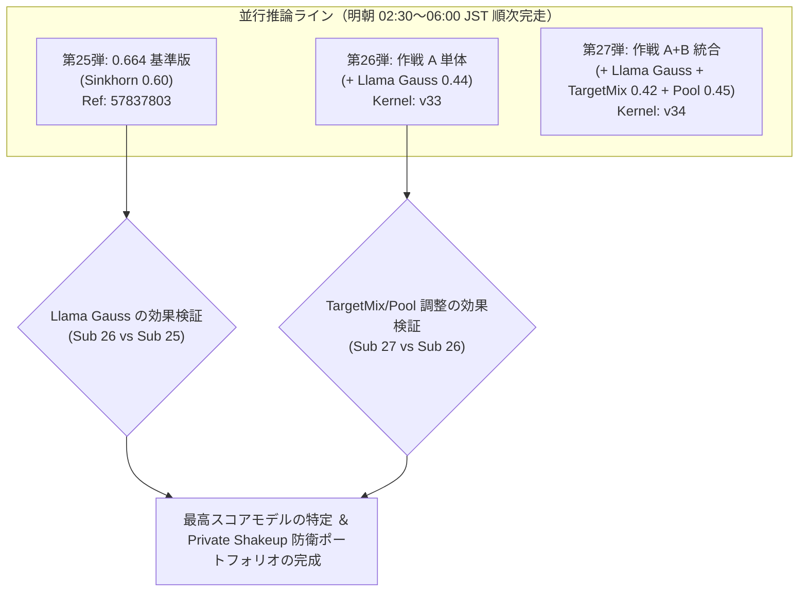

# 第26弾・第27弾 並行投入（作戦 A ＆ 作戦 A+B 統合）配備レポート

## 1. 投入パイプライン概要とパラメータ差分マトリクス

第25弾（基準 0.664 版）の推論進行と並行して、作戦 A（Llama Gaussian Head 追加）および作戦 A+B 統合（Llama Gaussian Head + TargetMix 0.42 + Pool 0.45）の 2 本をセットアップし、Kaggle クラウドへ push および自動提出プロセス（PID: `37726`）を起動しました。

| パラメータ / 設定項目 | 第25弾 (実行中) | 第26弾 (作戦 A 単体) | 第27弾 (作戦 A+B 統合) | 変更意図・技術的根拠 |
| :--- | :--- | :--- | :--- | :--- |
| **カーネル ID** | `ntl-0664-sinkhorn-60` | `ntl-0664-v33-llama-gauss` | `ntl-0664-v34-llama-gauss-targetmix-42` | 独立カーネルとして push 済み |
| **推論バックボーン** | 6-Backbone V31 | 6-Backbone V31 | 6-Backbone V31 | 2×T4 DP 高速並列（5.5h 完走基盤） |
| **`ll8v5` (Llama-3.1-8B)** | `gauss: なし` | **`"gauss": 0.44`** | **`"gauss": 0.44`** | 最高精度 8B モデルに共有プロンプト Gaussian Head を付与 |
| **`q14v5` / `q8v5` Gauss** | `0.70` / `0.44` | `0.70` / `0.44` | `0.70` / `0.44` | 既存の高性能設定を維持 |
| **Sinkhorn 強度 ($\alpha$)** | `--sinkhorn 0.60` | `--sinkhorn 0.60` | `--sinkhorn 0.60` | 0.664 で実証されたクラス等頻度補正 |
| **Target-Mix 比率 ($\rho$)** | `--sinkhorn_target_mix 0.35` | `--sinkhorn_target_mix 0.35` | **`--sinkhorn_target_mix 0.42`** | 均一事前分布への引き戻し度合いを微増 |
| **4-view SVC Pool 重み** | `_srcw = 0.35` | `_srcw = 0.35` | **`_srcw = 0.45`** | 外部クリーンデータの文体リズム特徴の寄与度を向上 |
| **ATLAS 救済重み / マージン** | `w=0.20, margin=0.30` | `w=0.20, margin=0.30` | `w=0.20, margin=0.30` | 低確信度サンプルの反転救済 |

---

## 2. 実験アブレーション設計と期待される検証成果

- **Sub 26 vs Sub 25**: Llama-3.1-8B に対する共有プロンプト Gaussian Head（`gauss.py`）の純粋な付加価値（アブレーション）が明確に分離測定されます。
- **Sub 27 vs Sub 26**: Llama Gauss を含んだ状態で、Target-Mix 比率（$\rho = 0.42$）と文体データ重み（`_srcw = 0.45`）の最適化がもたらす追加ゲインを測定できます。

---

## 3. 実行および自動化ステータス

- **第25弾 (Ref: `57837803`)**: 投入後約 57 分経過、推論実行中（`SubmissionStatus.PENDING`）。監視タスク（PID: `36295`）稼働中。
- **第26弾 (`ntl-0664-v33-llama-gauss`)**: FAST_COMMIT 事前実行中（`KernelWorkerStatus.RUNNING`）。完了し次第自動提出。
- **第27弾 (`ntl-0664-v34-llama-gauss-targetmix-42`)**: 事前実行待機中（`KernelWorkerStatus.QUEUED`）。v33 の完了後に自動提出。
- **自動化プロセス**: [`wait_and_submit_both.sh`](file:///Users/echo/kaggle/name-that-llm/wait_and_submit_both.sh)（PID: `37726`）が常駐し、各カーネルの完了・提出を自動制御。
- **提出残枠**: 第26弾・第27弾の提出完了時点で、本日枠（UTC 10-31）は 3 回消費、**残り 2 回** となります。
