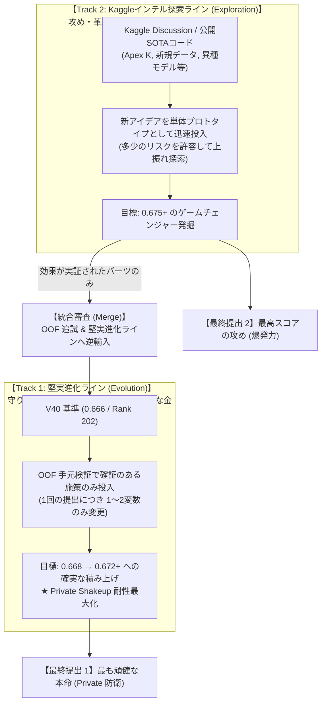

# Dual-Track R&D 運用体制・スロット配分規律（戦略プロトコル）

本ドキュメントは、Kaggle「Name That LLM」において銀メダル圏（Top 4.4% / Rank 202）を死守しつつ金メダル圏（Top 18 / 0.697+）へ進出するために策定された、**「Dual-Track R&D フレームワーク」** の運用プロトコルを定義するものです。

---

## 1. 2系統分割（Dual-Track）の基本理念

---

## 2. Track 別の責務と運用ルール

### 【Track 1: Evolution（堅実進化ライン）】
- **目的**: チームの最高実績である **V40（0.666）** を守備のベースラインとし、確実にスコアを 0.668 $\rightarrow$ 0.672+ へ引き上げる。
- **行動指針**:
  - **OOF ゲート必須**: 手元の 5-Fold OOF（2,699件）で Balanced Accuracy の向上が確認できない施策は提出しない。
  - **1回につき 1〜2 変数のみ変更**: 変更点を厳密に絞り込み、何が効いたのかを完全に特定する。
  - **Private Shakeup 耐性最優先**: 過剰適合（LB フィッティング）を排除し、テストデータ分布の揺らぎに頑健なパラメータ（Sinkhorn 0.50 等）を死守する。

### 【Track 2: Exploration（インテル探索ライン）】
- **目的**: Kaggle Discussion や高スコア公開ノートブック（0.667+ や 0.670+）から、未知の有効パーツや新手法を迅速にプロトタイプ検証する。
- **行動指針**:
  - **高リスク・高リターンの許容**: Public LB 上振れを狙う大胆な構成（異種モデル換装、新規擬似ラベル、極端なパラメータ等）を試行する。
  - **使い捨て前提のスピード重視**: 複雑な統合作業をせず、新パーツ単体または最小限のスタックで効果の有無を迅速判定する。
  - **逆輸入（Merge）プロトコル**: Track 2 で有意なスコア向上が確認された場合のみ、手元 OOF で再現テストを行い、合格したパーツだけを Track 1 へ正式採用する。

---

## 3. スロット配分（1日5回）の厳格規律

毎朝 09:00 JST（UTC 00:00）に付与される **1日 5 回のスロット** は、以下の比率で配分します。

| スロット枠 | 割り当て系統 | 目的・用途 |
| :---: | :---: | :--- |
| **Slot 1** | **Track 1 (Evolution)** | 前日の最良設定をベースにした堅実進化版の投入（本命） |
| **Slot 2** | **Track 1 (Evolution)** | Track 1 のパラメータ切り分け（アブレーション比較版） |
| **Slot 3** | **Track 2 (Exploration)** | Kaggle 上の最新アイデア・外部パーツのプロトタイプ投入 |
| **Slot 4** | **Track 2 (Exploration)** | 外部新兵器の比較検証または急遽浮上した有力仮説の検証 |
| **Slot 5** | **戦略予備枠 (Buffer)** | 深夜・早朝のリカバリー、または当日最も良好だった系統の発展追撃 |

---

## 4. 最終選定（Final 2 Submissions）の出口戦略

コンペ終了時（Deadline）に選択する **2本の最終サブミッション** は、本体制の成果から以下のように選定します。

1. **第1サブミッション（Private 防衛本命 / 守りの刀）**:
   - **Track 1** から輩出された「OOF と Public LB の乖離が最も小さく、過剰正則化を施した最高精度のモデル」。
   - 目的：Private LB Shakeup（大転落）を確実に防ぎ、銀メダル以上を確定させる。
2. **第2サブミッション（Gold 突破対抗 / 攻めの槍）**:
   - **Track 2** の成果を統合した「Public LB で最高スコアを記録した、最もアグレッシブなモデル」。
   - 目的：未知の Private テスト分布がハマった場合の金メダル（Top 18）ジャンプアップを狙う。

---

## 5. 現在の推論ジョブ（V42 A/B/C）の位置付け

現在推論中（~23:25 JST 完走予定）の 3 本は、すべて **Track 1（Evolution）における厳密なアブレーション** として位置付けられます。

- **V42-C (Ref: 57977543)**: `Track 1` - V40 完全同条件アンカー（Mix 0.35 + Apex-II）
- **V42 (Ref: 57977217)**: `Track 1` - 積極的最適化（Mix 0.42 + Apex-II）
- **V42-B (Ref: 57977214)**: `Track 1` - 保守アブレーション（Mix 0.42 + Sibling 0.05）

明朝 09:00 JST（スロット全回復）以降、**Track 2（インテル探索）の第1弾プロトタイプ** を投入し、両輪での並行攻略を本格稼働させます。
