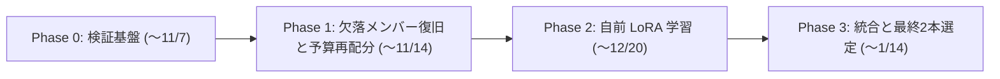

# Name That LLM: ゴールドメダル戦略 v2（補強版）

**改訂日時**: 2026-11-01 23:00 JST
**v1 からの主な変更**: 前提の検証結果を反映し、ロードマップ・期待値・判定基準を全面的に見直し

---

## 0. v1 の訂正事項（検証により判明）

> [!WARNING]
> v1 には検証していない前提が含まれていました。以下を訂正します。

| # | v1 での記述 | 検証結果 | 影響 |
| :--- | :--- | :--- | :--- |
| 1 | 「最終週」「2〜3日」など、締切が近い前提のロードマップ | 締切は **2027-01-14 23:59 UTC**（`kaggle competitions list` で確認）。**残り約 74 日** | 自前でモデルを学習する時間が十分にある。戦略の重心が変わる |
| 2 | 柱1「階層型二段階分類」を新規施策として提案 | `comp_stack.py` に **ファミリーゲートが既に実装済み**（`FAMILY_IDX` で claude/gpt/gemini/glm、LinearSVC による `family_gate`） | 新規施策ではなく「既存ゲートの強化」として扱う必要がある |
| 3 | 柱2「ペアワイズ・センタリング」を新規施策として提案。`--perpassage 1` でセンタリングは実質オフと記述 | 実行コマンドは `--adapt_w 1.0 --adapt_thr 0.15` で、各モデルに `twin 0.35`。**クラスタ単位のセンタリング（twin）は既に有効** | 同上。v1 の「実質オフ」は誤り |
| 4 | 柱3「Token Attention の再有効化・UltraBERT の追加」 | どちらも `comp_stack.py` に組み込み済み。ただし `tokattn_q35` が要求する **Qwen3.5 バックボーンは `model_sources` に無い**ため、スキップされている可能性が高い（ログ未確認） | 「追加」ではなく「欠落メンバーの復旧」が正しい課題 |
| 5 | 各柱の推定ゲイン（`+0.012〜+0.016` 等）とファミリー分類 CV 92%+ | **根拠となる計測はしていません**。撤回します | 期待値は計測後に再設定する |
| 6 | 疎サンプリング検証ハーネスで `'...'` が `+0.00038` 改善 | ハーネスのベースモデルは TF-IDF + LR（スコア 0.375）で、本番（0.662）とは別物。試行間の標準偏差より小さい差の可能性が高い | 第30弾の効果はノイズの範囲に収まる見込み |

---

## 1. 判断材料となる事実

### 1.1 順位構造（2026-11-01 22:41 時点 / 4,172 チーム）

| 区分 | 順位 | スコア | 当チームとの差 |
| :--- | :--- | :--- | :--- |
| 1位 | 1 | 0.737 | +0.075 |
| **金メダル境界** | **18** | **0.689** | **+0.027** |
| 50位 | 50 | 0.668 | +0.006 |
| **銀メダル境界** | **208** | **0.664** | **+0.002** |
| **当チーム** | **約314** | **0.662** | — |
| 銅メダル境界 | 417 | 0.662 | 0 |

> [!NOTE]
> 金メダルの人数（10 + 0.2% × チーム数）と各境界スコアは、締切までの参加者増加とスコア上昇で変わります。過去のコンペでは終盤に境界が上がる傾向があるため、**最終的な金境界は 0.70 前後まで上がる可能性**を想定しておく必要があります（推測であり、保証はありません）。

### 1.2 Public LB の統計ノイズ

- テスト約 4,000 行のうち Public 40% ≒ 1,600 行 → 正解率の標準誤差は **約 0.012**
- Private 60% ≒ 2,400 行 → 標準誤差は **約 0.010**
- 同じテスト行で比べるため提出間の**差**のノイズはこれより小さいものの、**0.001〜0.003 の差は「改善した」と判断できる大きさではありません**
- 結論: 第23〜30弾の 0.659〜0.662 の上下は、大半がノイズまたは ATLAS の途中打ち切りで説明できます。**Public LB の 0.001 を追う運用は金メダルにはつながりません**

### 1.3 リソース制約

| 項目 | 値 | 意味 |
| :--- | :--- | :--- |
| 残り日数 | 約 74 日 | 自前学習が現実的な選択肢になる |
| 1日の提出上限 | 5 回 | 74日で最大 約370回（実際は推論 5〜7h が律速） |
| 推論上限 | 9 時間 | 現行は約 5.5h。**余裕は約 2.5h**（ATLAS 予算との兼ね合いあり） |
| Kaggle GPU 枠 | 週あたりの上限あり（具体的な時間は要確認） | 学習と提出推論が同じ枠を取り合う |
| ローカル回線 | GB 単位のダウンロード禁止 | 学習・推論は Kaggle 上で行う |

---

## 2. ギャップ +0.027 の考え方

現行パイプラインは **公開ノートブックの集合体**（ATLAS、L24 アダプタ、comp_stack 等）です。銀〜銅圏の数百チームが同じ部品を使っているため、0.662〜0.664 に密集しています。

**金圏との差は、公開部品の組み合わせ調整では埋まらない**と考えるのが妥当です。上位チームが何をしているかは非公開ですが、可能性が高いのは次のいずれかです（推測）:

1. 公開アダプタより強い、**自前で学習したモデル**（データ量・品質・学習方法の差）
2. **公開されていない外部データ**、またはより厳密に整備した外部データ
3. 公開メンバーとは**誤り方が異なる**モデルの追加（アンサンブル効果）

したがって戦略の重心は「後処理の微調整」から **「自前の強いメンバーを作り、それを正しく評価できる基盤を持つこと」** に移します。

---

## 3. 補強版ロードマップ

### Phase 0: 検証基盤の構築（最優先・〜11/7 目安）

**目的**: Public LB に頼らずに改善を判断できる状態にする。

1. **実アンサンブルの OOF（交差検証予測）を作る**
   - `infer.py` には既に `--sim`（プロンプト単位の fold を疑似テストにする）と `--sim_k`（1プロンプトあたりの件数を間引く）、`--save_lp`（ブレンド後の対数確率を保存）がある
   - これを Kaggle 上で 5 fold 分実行し、**本番と同じアンサンブルの OOF 対数確率**を手に入れる
   - 以降の後処理（Sinkhorn、タイポグラフィ、ファミリーゲート）の調整はこの OOF 上で行う
2. **ローカル評価と Public LB の対応を確認する**
   - 過去の提出（0.646 / 0.659 / 0.662）を同じ OOF 評価にかけ、順位が一致するか確認する
   - 一致しなければ評価方法を見直す（ここが不一致のまま先に進むのが最大のリスク）
3. **ファミリー単位の誤り分析**
   - 18×18 の混同行列、ファミリー判定の正解率、ファミリー内の兄弟モデル間の誤り率を実測する
   - v1 で撤回した「エラーの51%は兄弟間」「ファミリー判定 92%」をここで初めて数値として確定させる

**完了の判定基準**: OOF での過去提出の順位が Public LB の順位と矛盾しないこと

**コストとリスク**: GPU 時間を 5 fold 分（1 fold あたり数時間の見込み）消費する。train の一部を抜いて学習するため、本番より若干弱いモデルでの評価になる

### Phase 1: 欠落メンバーの復旧と時間予算の再配分（〜11/14 目安）

1. **実行ログでスキップされているメンバーを洗い出す**
   - 第28・29弾の実行ログで `SKIP` / `not attached` / `gate off` を確認する
   - 候補: `tokattn_q35`（Qwen3.5-9B が未添付の可能性）、Claude ゲート（`Claude API passages not attached` の可能性）
2. **復旧したメンバーごとに Phase 0 の OOF で寄与を測る**
   - `tokattn_q35` は comp_stack 内のコメントで **1.7〜2.7 時間の固定コスト**とされている。現在の余裕（約 2.5h）をほぼ使い切るため、ATLAS の対象行（`--atlas_margin`）との取捨選択が必要
3. **時間予算の最適化**
   - 各メンバーの「所要時間あたりの OOF 改善量」を表にし、9h 上限から安全余裕（最低 1.5h）を引いた範囲で配分を決める

**完了の判定基準**: OOF で +0.005 以上の改善、かつ推論時間 7.5h 以内

### Phase 2: 自前 LoRA モデルの学習（〜12/20 目安・金メダルの本命）

1. **学習データの整備**
   - 公式 train（2,699 行）に加え、外部プール（`crtproduction/name-that-llm-open-pool` 198k 件、`prvsiyan` 拡張データ等）を利用
   - **ライセンスとコンペ規約上の外部データ利用条件を必ず確認する**（未確認）
   - 外部データのラベル品質は検証されていないため、公式 train で学習したモデルとの一致率でフィルタする（ノイズ除去）
2. **学習対象**
   - Qwen3-8B / 14B（既に `model_sources` に添付済みで追加ダウンロード不要）の LoRA 分類ヘッド
   - 評価は必ず **プロンプト単位の GroupKFold**（同じプロンプトの回答が学習と評価に分かれないようにする）
3. **アンサンブルへの組み込み判断**
   - 単体性能だけでなく、**既存アンサンブルとの誤りの相関**を測る。単体で弱くても誤り方が違えば効く

**完了の判定基準**: 既存アンサンブルに追加して OOF で +0.010 以上

**リスク**:
- Kaggle の GPU 週枠を学習が大きく消費し、提出推論の回数が減る
- 外部データ由来のラベルノイズで逆に悪化する可能性
- 14B の学習は T4 では時間的に厳しい可能性がある（P100/T4 の 1 セッション上限内に収まるか要確認）

### Phase 3: 統合と最終 2 本の選定（〜1/14）

- **最終選定は 2 本**（Kaggle の通常ルール。本コンペの規定は要確認）
  - 1本目: OOF が最良のもの
  - 2本目: 1本目と構成が異なり、OOF がほぼ同等のもの（Private での外れリスクを分散）
- **Public LB の順位だけで選ばない**。OOF と Public の両方で上位のものを優先する
- 推論時間は **実測 7.5h 以内** を必須条件にする（9h 超過は失格）

---

## 4. 当面（今夜〜今週）の具体的アクション

| 優先度 | 内容 | 所要 | 備考 |
| :--- | :--- | :--- | :--- |
| 1 | 第30弾の結果確認（01:10〜01:25 頃完了見込み） | 監視中 | 結果が 0.662±0.002 でもノイズの範囲として扱う |
| 2 | 第28・29弾の実行ログから SKIP されたメンバーを確認 | 小 | ログのみ取得（GB 単位のダウンロードは避ける） |
| 3 | `--sim` + `--save_lp` を使った OOF 生成ノートブックを作成し 1 fold で試走 | 中 | Phase 0 の起点 |
| 4 | 外部データの利用規約・ライセンス確認 | 小 | Phase 2 の前提条件 |
| 5 | 本日の残り提出枠 2 回 | — | **Public LB の微調整には使わない**ことを推奨。使うなら Phase 1 の候補（メンバー復旧版）の動作確認に充てる |

---

## 5. リスク一覧

| リスク | 発生可能性 | 影響 | 対策 |
| :--- | :--- | :--- | :--- |
| OOF と Public LB の傾向が一致しない | 中 | 大 | Phase 0 で必ず確認。一致しない場合は評価方法の修正を優先 |
| 推論 9h 超過による失格 | 低〜中 | 極大 | 実測 7.5h 上限、ATLAS 予算の自動調整を維持 |
| 自前学習が既存公開アダプタを上回らない | 中 | 大 | 単体性能でなく誤り相関で判断。だめなら外部データ品質改善に切り替え |
| Private で順位が大きく変動 | 中 | 大 | 最終2本を構成の異なるものに分散 |
| 金境界が終盤に 0.70 前後まで上昇 | 中 | 大 | 目標を 0.700 に置いて計画する |
| 外部データの規約違反 | 低 | 極大（失格） | 利用前に規約を確認 |

---

## 6. 期待値について

- 金メダル到達は **保証できません**。現状から +0.027（境界上昇を見込むと +0.035 前後）は、公開部品の調整では到達例が見当たらない幅です
- 銀メダル（+0.002）は、Phase 1 の欠落メンバー復旧で到達する可能性がありますが、Public のノイズ（SE≈0.012）を考えると Private で銀圏に残るかは不確実です
- 各フェーズの期待改善幅は、**Phase 0 で検証基盤ができた時点で実測に基づき再設定**します
