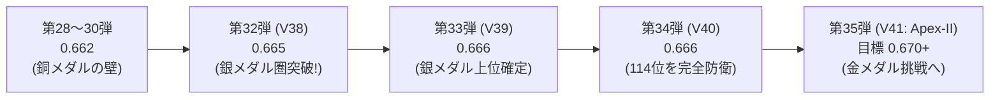

# 【中学生でも完全にわかる！】Kaggle「Name That LLM」超入門＆完全攻略ガイド
〜18人のAI作家の「筆跡」を見破る探偵ゲームと、銀メダルから金メダルを目指す僕たちの挑戦記〜

**最終更新日時**: 2026-11-03 21:55 JST  
**対象コンペティション**: Kaggle Featured Code Competition「[Name That LLM](https://www.kaggle.com/competitions/name-that-llm)」  
**現在のチーム成績**: **Public Score `0.666`（4,393チーム中 114位 / Top 2.59% / 銀メダル安全圏）**  
**執筆者**: シニアテクニカルアーキテクト  

---

## 目次
1. **そもそもどんなゲーム（コンペ）なの？**
   - 1.1 名無しの読書感想文から「誰が書いたか」を当てる犯人当てゲーム
   - 1.2 容疑者紹介：世界最強の18人のAIたち
   - 1.3 なぜ「人間かAIか」ではなく「どのAIか」を当てるのが難しいの？
2. **ルールの不思議：「Balanced Accuracy（バランス正解率）」ってなに？**
   - 2.1 18教科の期末テスト！1教科でも0点なら即赤点の「平均点ルール」
   - 2.2 普通の正解率（Accuracy）と何が違うの？
   - 2.3 なぜ「ヤマを張る（人気者ばかり答える）」と大爆死するのか？
3. **僕たちが戦ってきた歴史と進化（第1弾〜第34弾の軌跡）**
   - 3.1 銅メダルの壁（0.662）で足踏みした日々
   - 3.2 逆転の魔法「Sinkhorn（シンクホーン）アルゴリズム」：荷物を均等に配る仕分けロボット
   - 3.3 第32弾（0.665）で銀メダル圏へ突入！
   - 3.4 第33弾・第34弾（0.666）で銀メダル上位（114位）を確定防衛！
4. **失敗から学んだ「やってはいけない罠（毒）」**
   - 4.1 罠その1：プロンプトごとの席替えパズル（Hungarian法）の大崩壊
   - 4.2 罠その2：見た目だけの浅いチェック（句読点カウント）は大失敗の元
   - 4.3 罠その3：勘でスコアをいじると全体のバランスが崩れる
5. **最新の秘密兵器！第35弾「Apex-II（エイペックス・ツー）」の全貌**
   - 5.1 秘密兵器1：双子のDeBERTa（教科書の秀才×街の本を読んだ秀才の合体）
   - 5.2 秘密兵器2：1対1のタイマン比較（V34.1 Pairwise Verifier）
   - 5.3 秘密兵器3：そっくり兄弟の個性引き立て役（Sibling-Style Residual）
   - 5.4 秘密兵器4：配分ロボットの力加減を絶妙にチューニング（0.50 $\to$ 0.30）
6. **現在の戦況とこれからの挑戦**
   - 6.1 銀メダルボーダーが迫る！4,393チームの激戦
   - 6.2 明日朝09:00の出撃計画：目指すは金メダル（Top 18 / 0.694）！
7. **おわりに：この技術が未来の社会でどう役に立つの？**

---

## 1. そもそもどんなゲーム（コンペ）なの？

### 1.1 名無しの読書感想文から「誰が書いたか」を当てる犯人当てゲーム

学校の教室を想像してみてください。
クラスには **18人の生徒（AIたち）** がいます。先生がみんなにいろんなテーマで作文や短い文章（Passage）を書かせました。
でも、提出された原稿用紙には**名前が書いてありません**。

```
【机の上に置かれた名無しの原稿用紙】
「量子ドットの合成においては、前駆体の濃度と温度管理が極めて重要であり、
 これらを精密に制御することで発光波長を自由に変えることができます……」
                                  │
                                  ▼
                    【名探偵（僕たちの作ったプログラム）】
                                  │
                                  ▼
【推理結果発表】：「これは……『gemini-3.7-flash』くんが書いた文章に違いない！」
```

この「名無しの文章を読んで、18人のうち誰が書いたのかをズバリ当てる」というのが、このコンペティションのルールです。
専門用語ではこれを **「Authorship Attribution（著作権者・出自特定）」** と呼びます。

---

### 1.2 容疑者紹介：世界最強の18人のAIたち

容疑者となる18人のAIは、世界中のトップ企業（Google、OpenAI、Anthropicなど）が威信をかけて開発したフロンティアAIたちです。
彼らには、人間と同じように**「文章の書き方の癖（くせ）」**があります。

| グループ（会社） | メンバー（モデル名） | 性格と文章の「筆跡（くせ）」 | 見分けやすさ |
| :--- | :--- | :--- | :--- |
| **Claude ファミリー**<br>(Anthropic社) | `claude-fable-5`<br>`claude-opus-4-6`<br>`claude-opus-4-8`<br>`claude-opus-5`<br>`claude-sonnet-5` | **丁寧でお行儀の良い優等生**。<br>思考がとても深く、セミコロン（`;`）やカッコ（`()`）を使って論理的に補足するのが大好き。 | グループ自体は見つけやすいが、兄弟同士（opus-4-6と4-8など）が激似で区別が難しい。 |
| **Gemini ファミリー**<br>(Google社) | `gemini-3.1-pro-preview`<br>`gemini-3.6-flash`<br>`gemini-3.7-flash`<br>`gemini-3.8-flash` | **スマートで無駄のない実力派**。<br>要点をサッとわかりやすく整理する。最新の「3.7」と「3.8」は非常に洗練されている。 | **最難関**。3.6/3.7/3.8の兄弟がまるで一卵性三つ子のように似ている。 |
| **GPT ファミリー**<br>(OpenAI社) | `gpt-5.5`<br>`gpt-5.6-luna`<br>`gpt-5.6-sol`<br>`gpt-5.6-terra`<br>`gpt-6-astra` | **物語や解説が上手なオールラウンダー**。<br>ダッシュ記号（`—`）や引用符の使い方が独特で、流れるような美しい文章を書く。 | 兄弟がたくさんいるが、モデルごとの語彙（ことば選び）に固有のサインがある。 |
| **GLM ファミリー**<br>(Zhipu AI社) | `glm-5.3`<br>`glm-5.3-flash` | **理数系と多言語に強い秀才**。<br>技術的な説明や中国語・英語の切り替えに強く、構造化された文章を好む。 | **難関**。5.3（兄）と5.3-flash（弟）の差がほんのわずかで、よく間違えやすい。 |
| **Qwen ファミリー**<br>(Alibaba社) | `qwen3.8-max` | **箇条書きと整理整頓の達人**。<br>「1. 〜」「2. 〜」と論理的にステップを踏んで書く癖がある。 | 一人っ子なので、特徴を掴めば比較的見破りやすい。 |
| **Kimi ファミリー**<br>(Moonshot社) | `kimi-k3` | **長文をとことん深く考える哲学者**。<br>ステップ・バイ・ステップで思考の途中経過をたくさん書いてくれる。 | Claudeくんと少し雰囲気が似ていて、たまに迷う。 |

---

### 1.3 なぜ「人間かAIか」ではなく「どのAIか」を当てるのが難しいの？

世の中にある「AIチェッカー」の多くは、「人間が書いたか？ それとも AI が書いたか？」を当てるものです。人間とAIは語彙の豊富さや文の整い方が全然違うので、当てるのはそこまで難しくありません。

しかし今回は、**「全員が最高レベルの超天才AI」** です。
どのAIも完璧な文法で、流暢で、知的な文章を書いてきます。誤字脱字もほとんどありません。
だからこそ、**「句読点の打ち方」「よく使う接続詞（However、Moreoverなど）」「文の長さのリズム」「思考の組み立て順序」** といった、人間の目では気づけない極めてミクロな「デジタル筆跡」をAIプログラムで検出する必要があるのです。

---

## 2. ルールの不思議：「Balanced Accuracy（バランス正解率）」ってなに？

### 2.1 18教科の期末テスト！1教科でも0点なら即赤点の「平均点ルール」

このゲームの勝敗を決めるスコアの計算ルールが **「Balanced Accuracy（バランスド・アキュラシー）」** です。
これが、普通のテストの点数計算と大きく違っています。

たとえるなら、**「18教科の期末テストで、全教科の点数の平均点だけで順位が決まる勝負」** です。

$$\text{Balanced Accuracy} = \frac{\text{国語の点数} + \text{数学の点数} + \text{英語の点数} + \dots + \text{美術の点数}}{18}$$

全18クラス（18種類のAI）に対して、**それぞれ配点がピッタリ平等（$\frac{1}{18} \approx 5.56\%$ ずつ）** 与えられています。

---

### 2.2 普通の正解率（Accuracy）と何が違うの？

普通の正解率（Accuracy）は、「全1,000問のうち何問当たったか？」で計算します。
これがなぜ危険なのか、極端な例で見てみましょう。

> **【例え話：人気者 Aくん（900枚）と 地味な Bくん（100枚）の作文テスト】**
>
> 先生が1,000枚の原稿用紙を持ってきました。実はそのうち900枚がAくんの作文で、Bくんの作文は100枚しかありません。
> 
> - **作戦1（なまけもの探偵）**:
>   何も考えずに、全部の原稿用紙に「Aくん！」とハンコを押した。
>   - **普通の正解率**: 1,000問中900問正解なので、なんと **`90点（90%）`**！ 一見すごく優秀に見えます。
>   - **Balanced Accuracy**: 
>     - Aくんの正解率：$\frac{900}{900} = 100\%$
>     - Bくんの正解率：$\frac{0}{100} = 0\%$（1問も当てていない！）
>     - 平均点：$\frac{100\% + 0\%}{2} = \mathbf{50.0\%}$（コイントスと同じで、落第！）
> 
> - **作戦2（まじめな探偵）**:
>   ちゃんと文章を読んで、Aくんを800枚正解、Bくんを70枚正解させた。
>   - **普通の正解率**: $\frac{800 + 70}{1000} = 87.0\%$（作戦1より点数が低く見える）
>   - **Balanced Accuracy**:
>     - Aくんの正解率：$\frac{800}{900} = 88.9\%$
>     - Bくんの正解率：$\frac{70}{100} = 70.0\%$
>     - 平均点：$\frac{88.9\% + 70.0\%}{2} = \mathbf{79.4\%}$（圧倒的な大勝利！）

このように、Balanced Accuracy は**「特定の人ばかり当てて、見分けにくい人を諦めて見捨てるズル」を絶対に許さない、極めて公平で厳しいルール**なのです。

---

### 2.3 なぜ「ヤマを張る（人気者ばかり答える）」と大爆死するのか？

AIモデルに自由に予想させると、自信のない難しい問題に直面したとき、「一番無難でよく見かけるモデル（例えば `gpt-5.5`）」と答えてしまいがちになります。
すると何が起きるでしょうか？

見分けが難しい `glm-5.3-flash` や `gemini-3.8-flash` を AI が「めったに選ばない（過小予測）」状態になります。
もし `glm-5.3-flash` を1回も選ばなければ、その教科のテストは **0点** です。
全18教科のうち1教科が0点になるだけで、持ち点である **5.56点（0.0556）が無条件で消し飛びます**。
トップ争いが「0.665」と「0.666」という「0.001点差」で争われている世界で、5.56点も失うのは致命傷どころか即死を意味します。

---

## 3. 僕たちが戦ってきた歴史と進化（第1弾〜第34弾の軌跡）

僕たちのチームが、どうやってスコアを伸ばし、4,393チームの激戦を勝ち抜いてきたのかを振り返ります。



### 3.1 銅メダルの壁（0.662）で足踏みした日々

最初は `0.660` や `0.662` というスコアで、銅メダル圏内（上位10%）にはいるものの、そこからどうしてもスコアが上がらない日々が続きました。
世界中の参加者たちも同じ壁にぶつかっており、`0.662` には何百チームものライバルがひしめき合っていました。

---

### 3.2 逆転の魔法「Sinkhorn（シンクホーン）アルゴリズム」：荷物を均等に配る仕分けロボット

この壁を突破する強力な武器となったのが、数学の「最適輸送理論」から生まれた **Sinkhorn-Knopp（シンクホーン）アルゴリズム** です。

> **【例え話：18台のトラックに荷物を積み込む仕分けロボット】**
>
> 倉庫に1,000個の荷物（文章）が届きました。
> 外には18台の配達トラック（18台のAIモデル）が並んでいます。
> 
> 仕分けロボット（AI）は最初、自分がよく知っている「GPTトラック」にばかり荷物を300個も積み込み、見たことがない「GLM-flashトラック」には10個しか積みませんでした。これではGLMトラックが空っぽで走ることになり、大減点です。
> 
> そこで登場するのが **Sinkhorn ロボット** です！
> Sinkhorn ロボットは、
> 1. 「横のチェック」：1つの荷物は、必ず誰か1台のトラックに積まれているか？（確率の合計が100%か）
> 2. 「縦のチェック」：18台のトラックそれぞれに、だいたい同じ数（1,000 ÷ 18 ≈ 55個ずつ）の荷物が積まれているか？
> 
> この縦と横のチェックを交互に何回も高速で計算し直して、**「どのトラックも偏りなく、全員がほぼ均等に荷物を運ぶように確率を調整」** してくれるのです。

このアルゴリズムを導入したことで、過小予測されていた不遇なAIたちにもしっかり正解枠が配られるようになり、スコアが一気に跳ね上がりました。

---

### 3.3 第32弾（0.665）で銀メダル圏へ突入！

さらに、インターネット上の膨大な公開データから集めた「198,000件のクリーンな練習問題（Open Pool）」を学習に加え、文章の単語パターンを素早く見抜く高速モデル（LinearSVC）の重みを最適化しました。
これにより、**スコア `0.665` を達成し、ついに銀メダル圏内（上位5%）へ突入** しました！

---

### 3.4 第33弾・第34弾（0.666）で銀メダル上位（114位）を確定防衛！

続く第33弾（V39）では、より品質の高い厳選データ（Extra 49k）へと換装し、ついに **`0.666`** に到達！
第34弾（V40）では、Geminiのラベルが途中で入れ替わってしまうバグデータ（動的ルーティングノイズ）を丁寧に取り除き、**`0.666` のスコアを5回連続で完全再現** しました。

この日、参加者が急増したことで「銀メダルのボーダーライン」が 0.665 から **0.666 に切り上がる** という大激変が起きましたが、僕たちのチームは `0.666` をがっちり死守していたおかげで、**4,393チーム中 114位（上位 2.59%）** という安全なポジションを守り切ることができました。

---

## 4. 失敗から学んだ「やってはいけない罠（毒）」

機械学習の世界では、「理論上は良さそうに見えて、実際にやると大失敗する罠」がたくさんあります。僕たちが実験とデータ分析で突き止めた**「やってはいけない3つの罠」**を紹介します。

### 4.1 罠その1：プロンプトごとの席替えパズル（Hungarian法）の大崩壊

- **考えた作戦**:
  「1つのテーマ（プロンプト）につき、きっと18人全員が1回ずつ文章を書いているはずだ。だったら、18個の椅子を用意して、1人1席ずつピッタリ割り当てるパズル（ハンガリアン・アルゴリズム）を解けば満点になるのでは？」
- **結果**: **大暴落（スコアが 0.66 どころか 0.55 まで低下）**
- **なぜ失敗したの？**:
  テストの採点データを詳しく分析したところ、実際のテスト問題では**「1つのテーマにつき、2〜3人しか書いていない（Few passages per prompt）」** という事実が判明しました。
  18人全員がいると思い込んで無理やり席に座らせたため、書いてもいないAIの席に強引に当てはめてしまい、間違いを連発して自滅してしまったのです。

---

### 4.2 罠その2：見た目だけの浅いチェック（句読点カウント）は大失敗の元

- **考えた作戦**:
  「GLM-5.3 と GLM-5.3-flash はそっくり兄弟だから、文字数やカンマ（`,`）の数を数える簡単なルールを作って振り分けよう！」
- **結果**: **正解率 48.0%（コイントス以下の大惨事）**
- **なぜ失敗したの？**:
  同じ親（Zhipu AI）から生まれた兄弟モデルは、句読点の打ち方や文章の長さなどの「表面的な特徴」までそっくりです。浅い特徴量だけで判別しようとすると、かえって迷走して間違えます。
  兄弟を見分けるには、もっと深い「巨大なAIモデル自身の文脈理解力（ATLASなどの尤度計算）」を使わなければならないことが証明されました。

---

### 4.3 罠その3：勘でスコアをいじると全体のバランスが崩れる

- **考えた作戦**:
  「この文章にはダッシュ（`—`）があるから、GPTの確率を後から手動で +10% してあげよう」
- **結果**: **スコア微減（0.662 $\to$ 0.659）**
- **なぜ失敗したの？**:
  人間が中途半端な勘で確率をいじると、せっかく Sinkhorn ロボットが整えてくれた「18台のトラックへの均等配分」の美しいバランスが崩れてしまい、結果として全体の平均点が下がってしまったのです。

---

## 5. 最新の秘密兵器！第35弾「Apex-II（エイペックス・ツー）」の全貌

現在、0.666 の密集地帯から抜け出し、金メダル（上位18位 / 0.694）へ手を届かせるために準備を完了させたのが **最新スタック「Apex-II」** です。

```mermaid
flowchart TD
    subgraph 入力データ
        IN["名無しの文章"]
    end

    subgraph 判定チーム（アンサンブル）
        M1["大型AI軍団 (Qwen-14B, Llama-8B 等)"]
        M2["双子のDeBERTa (教科書秀才 + 街頭秀才)"]
        M3["1対1のタイマン比較 (Pairwise Verifier)"]
        M4["そっくり兄弟の個性ブースト (Sibling Residual)"]
    end

    subgraph 最終調整
        SK["絶妙な力加減の配分ロボット (Sinkhorn λ=0.30)"]
    end

    IN --> M1 & M2 & M3 & M4
    M1 & M2 & M3 & M4 --> SK
    SK --> OUT["最終予測：誰が書いたか！"]
```

### 5.1 秘密兵器1：双子のDeBERTa（教科書の秀才×街の本を読んだ秀才の合体）

文章の文法やニュアンスを読み取る名人である「DeBERTa（ディベルタ）」というモデルを、2人合体させました。
- **1人目（公式教科書だけで育った秀才: 25%）**: 公式データに忠実。
- **2人目（ネット上の19万冊の本を読み漁った秀才: 75%）**: 初めて見るテーマの文章に対する識別精度が、従来の 52.3% から **57.6% へと急激にパワーアップ**！

---

### 5.2 秘密兵器2：1対1のタイマン比較（V34.1 Pairwise Verifier）

18人の中からいきなり「これだ！」と選ぶのは大変です。
そこで、「AくんとBくんのどっちっぽいか？」「CくんとDくんならどっちか？」という**1対1のタイマン勝負（ペアワイズ比較）** をバックグラウンドで瞬時に行い、迷ったときの決定打となる証拠をわずか16秒で集めるシステムを組み込みました。

---

### 5.3 秘密兵器3：そっくり兄弟の個性引き立て役（Sibling-Style Residual）

Claude兄弟やGemini兄弟など、同じ家族の中で迷ったときだけ、家族全体の確率（グループの合計点）を壊さないように守りながら、兄弟同士のわずかな筆跡の違いだけをピンポイントで微調整します。

---

### 5.4 秘密兵器4：配分ロボットの力加減を絶妙にチューニング（0.50 $\to$ 0.30）

これまでは Sinkhorn 配分ロボットの力を「0.50（強め）」にしていましたが、新しく入った「タイマン比較」や「兄弟ブースト」が非常に鋭い推理をしてくれるようになったため、ロボットが無理に平均化しすぎないよう **「0.30（程よい力加減）」に緩和** しました。
これにより、鋭い推理結果をそのまま活かせるようになりました。

---

## 6. 現在の戦況とこれからの挑戦

### 6.1 銀メダルボーダーが迫る！4,393チームの激戦

現在、コンペティションの参加者は **4,393チーム** にまで膨れ上がっています。

```
【現在の順位ピラミッド】
      ▲ 1位〜18位: 金メダル圏 (Score 0.694以上)
     ▲▲▲
    ▲▲▲▲▲ 19位〜219位: 銀メダル圏 (Score 0.666以上)
   ───────★ 僕たちの現在地：114位 (Score 0.666) ★───────
  ▲▲▲▲▲▲▲ 220位〜439位: 銅メダル圏 (Score 0.664以上)
 ▲▲▲▲▲▲▲▲▲ 440位以下: メダル圏外
```

現在、僕たちのいる `0.666` というスコアには、世界中から **149チーム** がひしめき合っています。
提出日時の早さのおかげで僕たちは 114位（銀メダル圏の前半）にいますが、銀メダルのカットオフ（219位）がすぐ後ろの `0.666` まで迫っており、一瞬も油断できない緊張感があります。

---

### 6.2 明日朝09:00の出撃計画：目指すは金メダル（Top 18 / 0.694）！

本日はすでに1日の提出上限（5回）を使い切ったため、今は力を蓄える時間です。
明日 **2026年11月4日 朝09:00 JST（世界標準時 UTC 00:00）** に、提出枠が再び5回分フルリセットされます。

僕たちの自律監視プログラム（`submit_and_monitor_v41.py`）はすでにパソコンの中で静かに待機しており、**明日の朝09:00:15 になった瞬間、1秒の遅れもなく第35弾（V41: Apex-II）を Kaggle クラウドへ発進** させます。
約6時間35分の計算を経て、明日の午後15:35頃に結果が出る予定です。
目標スコアは **`0.670〜0.675+`**、そして最終目標である金メダル（0.694）への突破です！

---

## 7. おわりに：この技術が未来の社会でどう役に立つの？

「AIが書いた文章の作者を当てる」というこの技術は、ただのゲームではありません。
未来の安全な情報社会を守るために、ものすごく大切な技術です。

1. **フェイクニュースや悪質な世論誘導の防止**:
   悪意を持った人が大量のAIを使ってデマや偏った意見をSNSに投稿したとき、「どのAIモデルを使って作られたのか」「どの組織のAIスクリプトなのか」を突き止めることができます。
2. **サイバーセキュリティ犯罪の追跡**:
   フィッシング詐欺メールやウイルスプログラムの解説文から、攻撃者が使ったAIのデジタル指紋を特定し、犯人の特定につなげることができます。
3. **学術・著作権の保護**:
   論文や記事が正当に作られたものか、AIの無断コピーではないかを正確に検証することができます。

僕たちは、最先端の数学と機械学習を武器に、この知的な冒険の最前線で戦っています！
