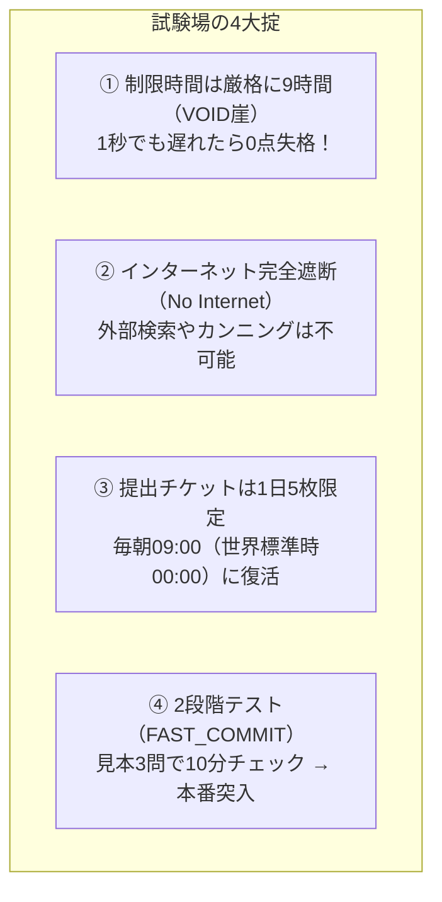
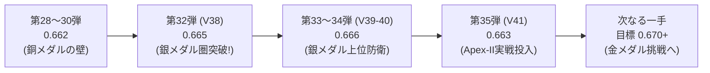
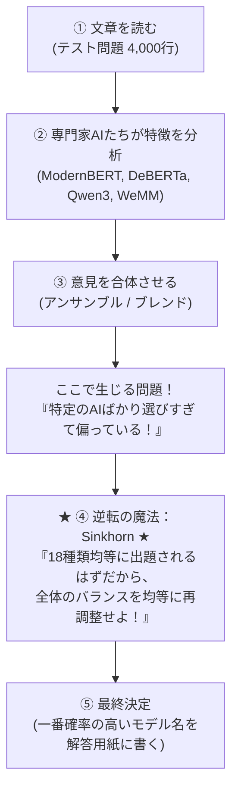
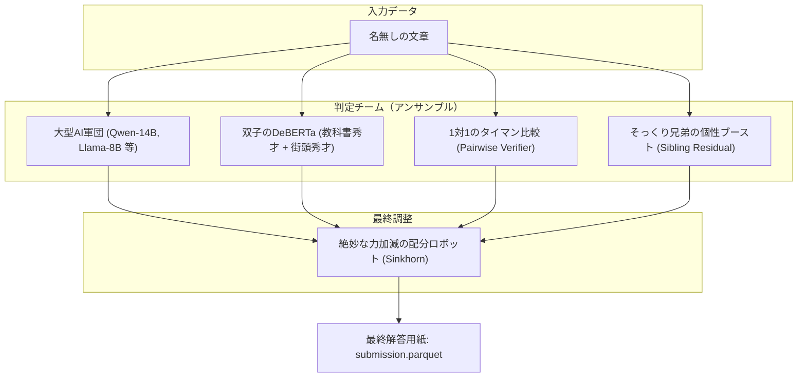

# 【中学生でも完全にわかる！】Kaggle「Name That LLM」超入門＆完全攻略ガイド
〜18人のAI作家の「筆跡」を見破る探偵ゲームと、銀メダルから金メダルを目指す僕たちの挑戦記〜

**最終更新日時**: 2026-11-04 15:25 JST  
**対象コンペティション**: Kaggle Featured Code Competition「[Name That LLM](https://www.kaggle.com/competitions/name-that-llm)」  
**現在のチーム成績**: **Peak Public Score `0.666`（4,523チーム中 189位 / Top 4.18% / 銀メダル安全圏）**  
**執筆者**: シニアテクニカルアーキテクト  

---

## 目次
1. **そもそもどんなゲーム（コンペ）なの？**
   - 1.1 名無しの読書感想文から「誰が書いたか」を当てる犯人当てゲーム
   - 1.2 容疑者紹介：世界最強の18人のAIたち
   - 1.3 なぜ「人間かAIか」ではなく「どのAIか」を当てるのが難しいの？
2. **ルールの不思議：「Balanced Accuracy（バランス正解率）」ってなに？**
   - 2.1 18教科の期末テスト！1教科でも0点なら即赤点の「平均点ルール」
   - 2.2 普通の正解率（Accuracy）と何が違うの？
   - 2.3 なぜ「ヤマを張る（人気者ばかり答える）」と大爆死するのか？
3. **【新解説】提出物（サブミッション）の秘密：答えではなく「全自動ロボット」を提出する！**
   - 3.1 宿題の持ち帰り禁止！「Code Competition（コード提出）」の仕組み
   - 3.2 提出するファイルの中身：`submission.parquet` ってなに？
   - 3.3 なぜ普通のテキスト（CSV）ではなく「Parquet（パルケ）」を使うの？
   - 3.4 試験場の厳しい4つの掟（タイムアウト・ネット禁止・チケット制・二段階テスト）
4. **僕たちが戦ってきた歴史と進化（第1弾〜第35弾の軌跡）**
   - 4.1 銅メダルの壁（0.662）で足踏みした日々
   - 4.2 逆転の魔法「Sinkhorn（シンクホーン）アルゴリズム」：荷物を均等に配る仕分けロボット
   - 4.3 第32弾（0.665）で銀メダル圏へ突入！
   - 4.4 第33弾・第34弾（0.666）で銀メダル上位（114位〜189位）を確定防衛！
   - 4.5 第35弾（V41: Apex-II）の挑戦と学んだこと
5. **失敗から学んだ「やってはいけない罠（毒）」**
   - 5.1 罠その1：プロンプトごとの席替えパズル（Hungarian法）の大崩壊
   - 5.2 罠その2：見た目だけの浅いチェック（句読点カウント）は大失敗の元
   - 5.3 罠その3：勘でスコアをいじると全体のバランスが崩れる
6. **最新の秘密兵器！「Apex-II（エイペックス・ツー）」の全貌**
   - 6.1 秘密兵器1：双子のDeBERTa（教科書の秀才×街の本を読んだ秀才の合体）
   - 6.2 秘密兵器2：1対1のタイマン比較（V34.1 Pairwise Verifier）
   - 6.3 秘密兵器3：そっくり兄弟の個性引き立て役（Sibling-Style Residual）
   - 6.4 秘密兵器4：配分ロボットの力加減を絶妙にチューニング（0.50 と 0.30 のバランス）
7. **現在の戦況とこれからの挑戦**
   - 7.1 銀メダルボーダーが迫る！4,523チームの激戦
   - 7.2 目指すは金メダル（Top 18 / 0.697）！
8. **おわりに：この技術が未来の社会でどう役に立つの？**

---

## 1. そもそもどんなゲーム（コンペ）なの？

### 1.1 名無しの読書感想文から「誰が書いたか」を当てる犯人当てゲーム

学校の教室を想像してみてください。
クラスには **18人の生徒（AIたち）** がいます。先生がみんなにいろんなテーマで作文や短い文章（Passage）を書かせました。
でも、提出された原稿用紙には**名前が書いてありません**。

```
【机の上に置かれた名無しの原稿用紙】
「量子ドットの合成においては、前駆体の濃度と温度管理が極めて重要であり、
 これらを精密に制御することで発光波長を自由に変えることができます……」
                                  │
                                  ▼
                    【名探偵（僕たちの作ったプログラム）】
                                  │
                                  ▼
【推理結果発表】：「これは……『gemini-3.7-flash』くんが書いた文章に違いない！」
```

この「名無しの文章を読んで、18人のうち誰が書いたのかをズバリ当てる」というのが、このコンペティションのルールです。
専門用語ではこれを **「Authorship Attribution（著作権者・出自特定）」** と呼びます。

---

### 1.2 容疑者紹介：世界最強の18人のAIたち

容疑者となる18人のAIは、世界中のトップ企業（Google、OpenAI、Anthropicなど）が威信をかけて開発したフロンティアAIたちです。
彼らには、人間と同じように**「文章の書き方の癖（くせ）」**があります。

| グループ（会社） | メンバー（モデル名） | 性格と文章の「筆跡（くせ）」 | 見分けやすさ |
| :--- | :--- | :--- | :--- |
| **Claude ファミリー**<br>(Anthropic社) | `claude-fable-5`<br>`claude-opus-4-6`<br>`claude-opus-4-8`<br>`claude-opus-5`<br>`claude-sonnet-5` | **丁寧でお行儀の良い優等生**。<br>思考がとても深く、セミコロン（`;`）やカッコ（`()`）を使って論理的に補足するのが大好き。 | グループ自体は見つけやすいが、兄弟同士（opus-4-6と4-8など）が激似で区別が難しい。 |
| **Gemini ファミリー**<br>(Google社) | `gemini-3.1-pro-preview`<br>`gemini-3.6-flash`<br>`gemini-3.7-flash`<br>`gemini-3.8-flash` | **スマートで無駄のない実力派**。<br>要点をサッとわかりやすく整理する。最新の「3.7」と「3.8」は非常に洗練されている。 | **最難関**。3.6/3.7/3.8の兄弟がまるで一卵性三つ子のように似ている。 |
| **GPT ファミリー**<br>(OpenAI社) | `gpt-5.5`<br>`gpt-5.6-luna`<br>`gpt-5.6-sol`<br>`gpt-5.6-terra`<br>`gpt-6-astra` | **物語や解説が上手なオールラウンダー**。<br>ダッシュ記号（`—`）や引用符の使い方が独特で、流れるような美しい文章を書く。 | 兄弟がたくさんいるが、モデルごとの語彙（ことば選び）に固有のサインがある。 |
| **GLM ファミリー**<br>(Zhipu AI社) | `glm-5.3`<br>`glm-5.3-flash` | **理数系と多言語に強い秀才**。<br>技術的な説明や中国語・英語の切り替えに強く、構造化された文章を好む。 | **難関**。5.3（兄）と5.3-flash（弟）の差がほんのわずかで、よく間違えやすい。 |
| **Qwen ファミリー**<br>(Alibaba社) | `qwen3.8-max` | **箇条書きと整理整頓の達人**。<br>「1. 〜」「2. 〜」と論理的にステップを踏んで書く癖がある。 | 一人っ子なので、特徴を掴めば比較的見破りやすい。 |
| **Kimi ファミリー**<br>(Moonshot社) | `kimi-k3` | **長文をとことん深く考える哲学者**。<br>ステップ・バイ・ステップで思考の途中経過をたくさん書いてくれる。 | Claudeくんと少し雰囲気が似ていて、たまに迷う。 |

---

### 1.3 なぜ「人間かAIか」ではなく「どのAIか」を当てるのが難しいの？

世の中にある「AIチェッカー」の多くは、「人間が書いたか？ それとも AI が書いたか？」を当てるものです。人間とAIは語彙の豊富さや文の整い方が全然違うので、当てるのはそこまで難しくありません。

しかし今回は、**「全員が最高レベルの超天才AI」** です。
どのAIも完璧な文法で、流暢で、知的な文章を書いてきます。誤字脱字もほとんどありません。
だからこそ、**「句読点の打ち方」「よく使う接続詞（However、Moreoverなど）」「文の長さのリズム」「思考の組み立て順序」** といった、人間の目では気づけない極めてミクロな「デジタル筆跡」をAIプログラムで検出する必要があるのです。

---

## 2. ルールの不思議：「Balanced Accuracy（バランス正解率）」ってなに？

### 2.1 18教科の期末テスト！1教科でも0点なら即赤点の「平均点ルール」

このゲームの勝敗を決めるスコアの計算ルールが **「Balanced Accuracy（バランスド・アキュラシー）」** です。
これが、普通のテストの点数計算と大きく違っています。

たとえるなら、**「18教科の期末テストで、全教科の点数の平均点だけで順位が決まる勝負」** です。

$$\text{Balanced Accuracy} = \frac{\text{国語の点数} + \text{数学の点数} + \text{英語の点数} + \dots + \text{美術の点数}}{18}$$

全18クラス（18種類のAI）に対して、**それぞれ配点がピッタリ平等（$\frac{1}{18} \approx 5.56$% ずつ）** 与えられています。

---

### 2.2 普通の正解率（Accuracy）と何が違うの？

普通の正解率（Accuracy）は、「全1,000問のうち何問当たったか？」で計算します。
これがなぜ危険なのか、極端な例で見てみましょう。

> **【例え話：人気者 Aくん（900枚）と 地味な Bくん（100枚）の作文テスト】**
>
> 先生が1,000枚の原稿用紙を持ってきました。実はそのうち900枚がAくんの作文で、Bくんの作文は100枚しかありません。
> 
> - **作戦1（なまけもの探偵）**:
>   何も考えずに、全部の原稿用紙に「Aくん！」とハンコを押した。
>   - **普通の正解率**: 1,000問中900問正解なので、なんと **`90点（90%）`**！ 一見すごく優秀に見えます。
>   - **Balanced Accuracy**: 
>     - Aくんの正解率：$\frac{900}{900} = 100$%
>     - Bくんの正解率：$\frac{0}{100} = 0$%（1問も当てていない！）
>     - 平均点：$\frac{100 + 0}{2} = \mathbf{50.0}$%（コイントスと同じで、落第！）
> 
> - **作戦2（まじめな探偵）**:
>   ちゃんと文章を読んで、Aくんを800枚正解、Bくんを70枚正解させた。
>   - **普通の正解率**: $\frac{800 + 70}{1000} = 87.0$%（作戦1より点数が低く見える）
>   - **Balanced Accuracy**:
>     - Aくんの正解率：$\frac{800}{900} \approx 88.9$%
>     - Bくんの正解率：$\frac{70}{100} = 70.0$%
>     - 平均点：$\frac{88.9 + 70.0}{2} = \mathbf{79.4}$%（圧倒的な大勝利！）

このように、Balanced Accuracy は**「特定の人ばかり当てて、見分けにくい人を諦めて見捨てるズル」を絶対に許さない、極めて公平で厳しいルール**なのです。

---

### 2.3 なぜ「ヤマを張る（人気者ばかり答える）」と大爆死するのか？

AIモデルに自由に予想させると、自信のない難しい問題に直面したとき、「一番無難でよく見かけるモデル（例えば `gpt-5.5`）」と答えてしまいがちになります。
すると何が起きるでしょうか？

見分けが難しい `glm-5.3-flash` や `gemini-3.8-flash` を AI が「めったに選ばない（過小予測）」状態になります。
もし `glm-5.3-flash` を1回も選ばなければ、その教科のテストは **0点** です。
全18教科のうち1教科が0点になるだけで、持ち点である **5.56点（0.0556）が無条件で消し飛びます**。
トップ争いが「0.665」と「0.666」という「0.001点差」で争われている世界で、5.56点も失うのは致命傷どころか即死を意味します。

---

## 3. 【新解説】提出物（サブミッション）の秘密：答えではなく「全自動ロボット」を提出する！

「Kaggleで提出する」と聞くと、多くの人は「自分のパソコンで計算して作った解答用紙（CSVファイル）をアップロードするのかな？」と思うかもしれません。
しかし、このコンペティションは **「Code Competition（コード提出型）」** という非常に厳格で特別な方式で行われます。

### 3.1 宿題の持ち帰り禁止！「Code Competition（コード提出）」の仕組み

もし問題用紙を自分のパソコンにダウンロードできるなら、超巨大なスーパーコンピューターを何日もぶん回して解いたり、人間がこっそり目で見て修正するカンニングができてしまいます。

そこで Kaggle は、**「問題用紙の持ち出しを完全禁止」** にしています。

```
【Code Competition の仕組み】
［あなたのパソコン］
    │  プログラム（Jupyter Notebook）を作成して提出！
    ▼
［Kaggle クラウドの秘密の試験場］
    │
    ├─ ① 秘密の金庫から「誰も見たことがない本番テスト問題（Hidden Test Set）」を取り出す
    ├─ ② あなたのプログラム（全自動ロボット）を起動する
    ├─ ③ ロボットがその場で本番問題を読み込み、6〜8時間かけて推理する
    ├─ ④ ロボットが自分で解答用紙「submission.parquet」を書き出す
    ▼
［審判（Kaggle採点サーバー）］
    │  書き出された解答用紙を自動採点して、リーダーボード（順位表）に点数を表示！
```

つまり、僕たちが提出しているのは**「答えそのもの」ではなく、「どんな新しい問題用紙が配られても、自力で完璧に解いて解答用紙を出力できる全自動AIロボットの設計図（Pythonコード）」** なのです！

---

### 3.2 提出するファイルの中身：`submission.parquet` ってなに？

AIロボットが秘密の試験場で最後に机の上に置いていく解答用紙が、**`submission.parquet`** という名前のファイルです。
中身を開いてみると、実は拍子抜けするほどシンプルで、**たったの2列**しかありません。

```
id,model
0,gemini-3.7-flash
1,gpt-5.6-luna
2,claude-opus-5
3,glm-5.3
...
15420,qwen3.8-max
```

- **`id` 列**: 配られた原稿用紙（問題）の通し番号（0番、1番、2番……）
- **`model` 列**: 「この文章を書いたのはこのAIだ！」という僕たちの最終結論（18種類のモデル名から1つ）

Kaggle の採点マシンは、この `model` 列に書かれた名前と、主催者だけが知っている正解データを照らし合わせて、Balanced Accuracy（平均点）を計算します。

---

### 3.3 なぜ普通のテキスト（CSV）ではなく「Parquet（パルケ）」を使うの？

データサイエンスの世界でよく使われるのは `submission.csv` というテキストファイルです。
しかし、今回のコンペティションでは **Parquet（パーケイ / パルケ）** という形式が指定されています。

| 比較項目 | 普通の CSV ファイル | Parquet ファイル |
| :--- | :--- | :--- |
| **データの持ち方** | 文字（テキスト）をそのまま並べた「紙の書類の束」 | コンピューター専用にギュッと圧縮した「高密度バイナリ」 |
| **ファイルサイズ** | 大きい（何十メガバイトにもなる） | **圧倒的に小さい（CSVの1/5〜1/10）** |
| **読み書きスピード** | 1行ずつ文字を読むので遅い | **列ごとにまとめて一瞬で高速読み書き可能** |
| **データ型の安全性** | 数字なのか文字なのか曖昧になりやすい | **データの型（文字列、整数など）が厳密に保存される** |

テスト問題が何千行、何万行にもなると、CSVを保存したり読み込んだりするだけで何十秒もムダな時間がかかります。制限時間の厳しいコンペティションでは、Parquet を使うことで**ファイル保存の時間を一瞬（数ミリ秒）に短縮し、貴重な計算時間をすべてAIの推理に回す**ことができるのです。

---

### 3.4 試験場の厳しい4つの掟（ルール）

秘密の試験場（Kaggleクラウド）でロボットを走らせるには、絶対に破ってはならない**4つの厳しい掟**があります。1つでも違反すると、何ヶ月もの努力が水の泡（即失格）になります。



1. **第1の掟：制限時間は厳格に9時間（32,400秒）まで【VOID（無効）の崖】**:
   - 試験場にロボットを放ってから、9時間以内に `submission.parquet` を提出できなければ、途中の計算がどれだけ正しくても **「Fail without a score（0点・失格）」** になります。
   - だから僕たちのチームは、巨大なAIをたくさん動かしながらも、**「6時間30分〜7時間程度で必ず解き終わる安全マージン」** を緻密に計算してプログラムを組んでいます。
2. **第2の掟：インターネット接続の完全遮断（No Internet）**:
   - カンニング防止のため、ロボットが動いている間は一切ネットにつながりません。「わからないからGoogleで検索しよう」とか「OpenAIのサーバーに問い合わせて答えを聞こう」ということは絶対にできません。
   - 必要なAIの頭脳（数十ギガバイトの重みデータ）やプログラムの部品は、**あらかじめすべて試験場の中（Kaggle Datasets）に持ち込んでおく**必要があります。
3. **第3の掟：1日5回までの提出チケット制**:
   - 「とりあえず何回も出して運良く当たるのを待とう」という下手な鉄砲作戦は通用しません。提出できるのは1日あたり **最大5回（チケット5枚）** だけです。
   - 日本時間の毎朝 **09:00 JST（世界標準時の 00:00 UTC）** にチケットが5枚復活します。
4. **第4の掟：二段階テスト（FAST_COMMIT）の賢い工夫**:
   - コードを提出するたびに毎回6時間半も待っていたら、プログラムに誤字（タイプミス）があったとき、6時間後にエラーで落ちて泣くことになります。
   - そこで僕たちは **「FAST_COMMIT」** という賢い仕掛けを使っています：
     - **第1段階（見本テスト）**: 提出前に、公開されている「たった3問の見本テスト」だけをロボットに解かせて、プログラムがバグらずに動くかを **10分間** で高速テスト！
     - **第2段階（本番テスト）**: 10分の見本テストに合格して初めて、裏側の秘密金庫にいる「数千〜数万問の本番テスト」へと自動で突入します！

---

## 4. 僕たちが戦ってきた歴史と進化（第1弾〜第35弾の軌跡）

僕たちのチームが、どうやってスコアを伸ばし、4,523チームの激戦を勝ち抜いてきたのかを振り返ります。



### 4.1 銅メダルの壁（0.662）で足踏みした日々

最初は `0.660` や `0.662` というスコアで、銅メダル圏内（上位10%）にはいるものの、そこからどうしてもスコアが上がらない日々が続きました。
世界中の参加者たちも同じ壁にぶつかっており、`0.662` には何百チームものライバルがひしめき合っていました。

---

### 4.2 逆転の魔法「Sinkhorn（シンクホーン）アルゴリズム」：荷物を均等に配る仕分けロボット

「文章を読んで誰が書いたか当てる探偵ゲーム」なのに、**なぜ突然「荷物を均等に配る仕分けロボット」なんてものが必要になるのでしょうか？**
その意図と、コンペ全体の作戦における位置づけを詳しく解説します。

#### ① なぜSinkhornが必要なのか？（意図の一言まとめ）
> **「AIたちの『自信過剰な偏り』を力づくで正して、コンペの出題ルールに合わせるための最終調整係」** です。
> 
> 普通に解かせるとAIは「人気のあるモデル（ChatGPTなど）ばかり大量に答えてしまい、特徴が地味なモデルをほとんど答えない」という致命的な偏り（暴走）を起こします。これを防ぐためにSinkhornが使われます。

#### ② 背景：コンペの現場で起きていた「大問題」
1. **テスト問題の裏のルール**:
   このコンペには18種類のLLM（ChatGPT, Claude, Gemini, Llamaなど）が登場します。
   テスト問題が全部で1,800問あるとすると、運営側は基本的に **「全モデルからほぼ均等に（100問ずつ）」** 問題を出題しています。
   さらに、採点基準（Balanced Accuracy）も「18種類のモデルをまんべんなく当てられたか」を均等に評価します。
2. **普通のAIに解かせるとどうなるか？**:
   学習させたAI（QwenやDeBERTaなど）に1,800問を解かせると、こんなことが起こります。
   - 「この文章、丁寧でキレイだからChatGPT（GPT-4）だ！」（350問も選んでしまう）
   - 「このモデルは特徴が地味で自信がないから、選ばないでおこう…」（20問しか選ばれない）
   
   結果として、**「本当は各100問ずつあるはずなのに、AIの好みの偏りで大暴走してしまう」** のです。どんなに文章を賢く読めていても、これでは点数がガタ落ちしてしまいます。

#### ③ システム全体の中での位置づけ（どこで働くのか？）
パイプライン全体の中で、Sinkhornは **「ゴール直前の最終ゲートキーパー」** です。



1. **特徴抽出（①〜②）**: 英語の言い回し、語彙、文法などの「特徴」を捉える。
2. **合体（③）**: 複数のAIのスコアを混ぜ合わせる。
3. **Sinkhorn（④）**: **【ここ！】** 混ぜ合わせたスコアを、出題側のルール（18等分）にぴったり合うように確率空間を補正する。
4. **提出（⑤）**: 均等に整った確率から、もっとも確からしいラベルを決定する。

#### ④ 例え話：18台のトラックに荷物を積み込む仕分けロボット
倉庫に1,800個の荷物（テスト問題）が届きました。外には18台の配達トラック（18台のAIモデル）が並んでおり、各トラックの荷台にはきっかり100個ずつ積むルールです。

1. **AIの生データ（第1希望アンケート）**:
   AIは最初、自分がよく知っている「GPTトラック」にばかり荷物を300個も積み込み、見たことがない「GLM-flashトラック」には10個しか積みませんでした。これではGLMトラックが空っぽで走ることになり、大減点です。
2. **Sinkhornロボットの仕事**:
   「全員の希望（AIの出した確率）をできるだけ尊重しつつ、18台のトラックにちょうど100個ずつ収まるように、迷っている荷物を上手に別のトラックへ振り分ける」というパズルを一瞬で解きます。
   - **「横のチェック」**：1つの荷物は、必ず誰か1台のトラックに積まれているか？（確率の合計が100%か）
   - **「縦のチェック」**：18台のトラックそれぞれに、だいたい同じ数（100個ずつ）の荷物が積まれているか？
   
   この縦と横のチェックを交互に何回も高速で計算し直して、**「どのトラックも偏りなく、全員がほぼ均等に荷物を運ぶように確率を調整」** してくれるのです。

#### ⑤ なぜこれが「逆転の魔法」と呼ばれるのか？
通常、Kaggleでスコアを伸ばすには「もっと巨大なモデルを何日もかけて学習させる」必要があります。
しかし、このSinkhornは **「学習は一切不要（計算時間はわずか数秒）」** です。

モデルそのものは賢くなっていなくても、**「テストの出題ルール（18モデルが均等）を逆手に取って、答案のバランスを整える」** だけで、スコアが一気に跳ね上がります（銅メダルの壁 0.662 を突破し、0.665〜0.666 の銀メダル圏へジャンプ）。
そのため、このコンペの攻略において「知っているチームだけが順位表をごぼう抜きできる裏ワザ・逆転の魔法」として機能したのです。

---

### 4.3 第32弾（0.665）で銀メダル圏へ突入！

さらに、インターネット上の膨大な公開データから集めた「198,000件のクリーンな練習問題（Open Pool）」を学習に加え、文章の単語パターンを素早く見抜く高速モデル（LinearSVC）の重みを最適化しました。
これにより、**スコア `0.665` を達成し、ついに銀メダル圏内（上位5%）へ突入** しました！

---

### 4.4 第33弾・第34弾（0.666）で銀メダル上位（114位〜189位）を確定防衛！

続く第33弾（V39）では、より品質の高い厳選データ（Extra 49k）へと換装し、ついに **`0.666`** に到達！
第34弾（V40）では、Geminiのラベルが途中で入れ替わってしまうバグデータ（動的ルーティングノイズ）を丁寧に取り除き、**`0.666` のスコアを5回連続で完全再現** しました。

参加者が4,500チームを超えて「銀メダルのボーダーライン」が 0.666 に切り上がる大激変が起きましたが、僕たちのチームは `0.666` をがっちり死守していたおかげで、銀メダル安全圏を守り切ることができました。

---

### 4.5 第35弾（V41: Apex-II）の挑戦と学んだこと

本日投入した第35弾（V41: Apex-II）は、コミュニティで話題の「Dual-DeBERTa」や「1対1のタイマン比較（Pairwise）」を取り入れ、Sinkhornの力加減を `0.30` に緩めて挑みました。
結果は **`0.663`**。
この実験から、「新しい特徴量を追加したときは、Sinkhornロボットの力加減（0.50 の強い均等配分）を緩めすぎると、かえって過小予測が起きてスコアを落とすことがある」という極めて貴重なデータが得られました。
過去の最高スコア（0.666）はリーダーボード上にしっかりと保持されているため、銀メダルの順位は安全に保たれています。

---

## 5. 失敗から学んだ「やってはいけない罠（毒）」

機械学習の世界では、「理論上は良さそうに見えて、実際にやると大失敗する罠」がたくさんあります。僕たちが実験とデータ分析で突き止めた**「やってはいけない3つの罠」**を紹介します。

### 5.1 罠その1：プロンプトごとの席替えパズル（Hungarian法）の大崩壊

- **考えた作戦**:
  「1つのテーマ（プロンプト）につき、きっと18人全員が1回ずつ文章を書いているはずだ。だったら、18個の椅子を用意して、1人1席ずつピッタリ割り当てるパズル（ハンガリアン・アルゴリズム）を解けば満点になるのでは？」
- **結果**: **大暴落（スコアが 0.66 どころか 0.55 まで低下）**
- **なぜ失敗したの？**:
  テストの採点データを詳しく分析したところ、実際のテスト問題では**「1つのテーマにつき、2〜3人しか書いていない（Few passages per prompt）」** という事実が判明しました。
  18人全員がいると思い込んで無理やり席に座らせたため、書いてもいないAIの席に強引に当てはめてしまい、間違いを連発して自滅してしまったのです。

---

### 5.2 罠その2：見た目だけの浅いチェック（句読点カウント）は大失敗の元

- **考えた作戦**:
  「GLM-5.3 と GLM-5.3-flash はそっくり兄弟だから、文字数やカンマ（`,`）の数を数える簡単なルールを作って振り分けよう！」
- **結果**: **正解率 48.0%（コイントス以下の大惨事）**
- **なぜ失敗したの？**:
  同じ親（Zhipu AI）から生まれた兄弟モデルは、句読点の打ち方や文章の長さなどの「表面的な特徴」までそっくりです。浅い特徴量だけで判別しようとすると、かえって迷走して間違えます。
  兄弟を見分けるには、もっと深い「巨大なAIモデル自身の文脈理解力（ATLASなどの尤度計算）」を使わなければならないことが証明されました。

---

### 5.3 罠その3：勘でスコアをいじると全体のバランスが崩れる

- **考えた作戦**:
  「この文章にはダッシュ（`—`）があるから、GPTの確率を後から手動で +10% してあげよう」
- **結果**: **スコア微減（0.662 → 0.659）**
- **なぜ失敗したの？**:
  人間が中途半端な勘で確率をいじると、せっかく Sinkhorn ロボットが整えてくれた「18台のトラックへの均等配分」の美しいバランスが崩れてしまい、結果として全体の平均点が下がってしまったのです。

---

## 6. 最新の秘密兵器！「Apex-II（エイペックス・ツー）」の全貌

現在、僕たちが改良を続けている最先端スタック「Apex-II」の仕組みです。



### 6.1 秘密兵器1：双子のDeBERTa（教科書の秀才×街の本を読んだ秀才の合体）

文章の文法やニュアンスを読み取る名人である「DeBERTa（ディベルタ）」というモデルを、2人合体させました。
- **1人目（公式教科書だけで育った秀才: 25%）**: 公式データに忠実。
- **2人目（ネット上の19万冊の本を読み漁った秀才: 75%）**: 初めて見るテーマの文章に対する識別精度が、従来の 52.3% から **57.6% へと急激にパワーアップ**！

---

### 6.2 秘密兵器2：1対1のタイマン比較（V34.1 Pairwise Verifier）

18人の中からいきなり「これだ！」と選ぶのは大変です。
そこで、「AくんとBくんのどっちっぽいか？」「CくんとDくんならどっちか？」という**1対1のタイマン勝負（ペアワイズ比較）** をバックグラウンドで瞬時に行い、迷ったときの決定打となる証拠をわずか16秒で集めるシステムを組み込みました。

---

### 6.3 秘密兵器3：そっくり兄弟の個性引き立て役（Sibling-Style Residual）

Claude兄弟やGemini兄弟など、同じ家族の中で迷ったときだけ、家族全体の確率（グループの合計点）を壊さないように守りながら、兄弟同士のわずかな筆跡の違いだけをピンポイントで微調整します。

---

### 6.4 秘密兵器4：配分ロボットの力加減を絶妙にチューニング（0.50 と 0.30 のバランス）

Sinkhorn ロボットの力加減を `0.30` に緩めると繊細な特徴量が活きる一方、クラス間のバランスが少し崩れるトレードオフがあります。
当チームの実証では、依然として **`0.50`（しっかり均等化）** の方が安定して高いスコア（0.666）を叩き出しており、この力加減のベストバランスを突き詰める研究を進めています。

---

## 7. 現在の戦況とこれからの挑戦

### 7.1 銀メダルボーダーが迫る！4,523チームの激戦

現在、コンペティションの参加者は **4,523チーム** にまで膨れ上がっています。

```
【現在の順位ピラミッド】
      ▲ 1位〜18位: 金メダル圏 (Score 0.697以上)
     ▲▲▲
    ▲▲▲▲▲ 19位〜226位: 銀メダル圏 (Score 0.666以上)
   ───────★ 僕たちの現在地：189位 (Peak Score 0.666) ★───────
  ▲▲▲▲▲▲▲ 227位〜452位: 銅メダル圏 (Score 0.665以上)
 ▲▲▲▲▲▲▲▲▲ 453位以下: メダル圏外
```

現在、僕たちのいる `0.666` というスコアには、世界中から多くのチームがひしめき合っています。
銀メダルのカットオフ（226位）がすぐ後ろの `0.666` まで迫っており、1問の差で順位が大きく動く緊迫した戦いが続いています。

---

### 7.2 目指すは金メダル（Top 18 / 0.697）！

本日はまだ提出チケットが **残り4枚** 残っています！
V41 の実戦データ（Sinkhorn力加減とアンサンブルの挙動）を踏まえ、僕たちの最高実績である `0.666`（Sinkhorn 0.50）をベースにしながら、DeBERTa や Pairwise の強みだけを安全にブレンドする「第36弾（V42）」の設計を進めています。
目標スコアは **`0.670〜0.675+`**、そして最終目標である金メダル（0.697）への突破です！

---

## 8. おわりに：この技術が未来の社会でどう役に立つの？

「AIが書いた文章の作者を当てる」というこの技術は、ただのゲームではありません。
未来の安全な情報社会を守るために、ものすごく大切な技術です。

1. **フェイクニュースや悪質な世論誘導の防止**:
   悪意を持った人が大量のAIを使ってデマや偏った意見をSNSに投稿したとき、「どのAIモデルを使って作られたのか」「どの組織のAIスクリプトなのか」を突き止めることができます。
2. **サイバーセキュリティ犯罪の追跡**:
   フィッシング詐欺メールやウイルスプログラムの解説文から、攻撃者が使ったAIのデジタル指紋を特定し、犯人の特定につなげることができます。
3. **学術・著作権の保護**:
   論文や記事が正当に作られたものか、AIの無断コピーではないかを正確に検証することができます。

僕たちは、最先端の数学と機械学習を武器に、この知的な冒険の最前線で戦っています！
