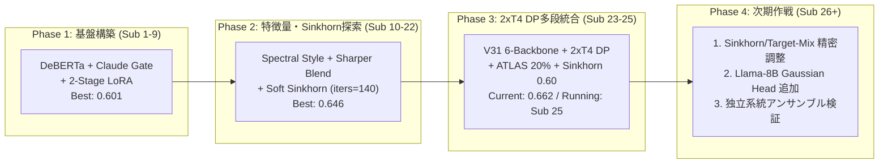
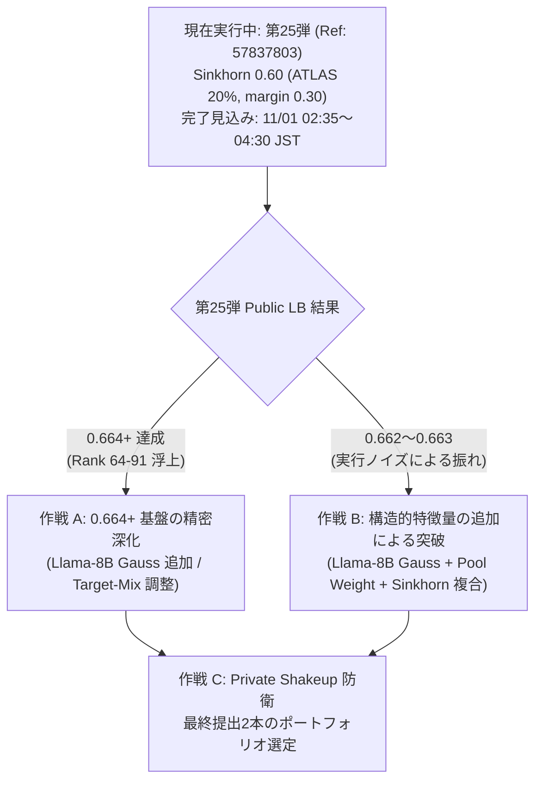

# Kaggle「Name That LLM」マスター戦略・作戦計画書

**作成日時**: 2026-10-31 21:45 JST  
**対象コンペティション**: [Name That LLM](https://www.kaggle.com/competitions/name-that-llm)（18クラスフロンティアLLM特定タスク）  
**評価指標**: Balanced Accuracy Score  
**最終締切**: 2027-01-14 23:59 UTC（日次提出上限: 5回 / 推論時間上限: 9時間 = 32,400秒）

---

## 1. エグゼクティブ・サマリー（現在地と戦況構造）

### 1.1 リーダーボード構造とメダル境界（2026-10-31 時点 / 4,042 チーム）

| 区分 | 順位目安 | スコア水準 | 戦況・構造的特徴 |
| :--- | :--- | :--- | :--- |
| **Top 1 位** | Rank 1 | `0.736` | 独自大規模プール生成・マルチステージ学習と推察される単独首位層 |
| **金メダル圏** | Rank 1 〜 18 | `0.683` 〜 `0.736` | Top 10 境界は `0.701`。公開モデルの単純ブレンドでは到達困難な領域 |
| **上位銀メダル圏** | Rank 19 〜 144 | `0.663` 〜 `0.682` | **`0.664` は Rank 64 〜 91（Top 1.5% 〜 2.2%）** に位置する安定圏 |
| **銀メダル境界帯** | Rank 145 〜 393 | **`0.662`** | **249 チームが同一スコア `0.662` に密集**。銀メダル閾値（Top 5% = Rank 202）がこの密集帯の内部に存在 |
| **銅メダル境界帯** | Rank 394 〜 404 | `0.657` 〜 `0.661` | Top 10% カットオフは `0.657` |
| **当チーム現在地** | **Rank 231** | **`0.662`** | 第23弾で Rank 168（銀圏）到達後、第24弾の同点更新により提出日時順で Rank 231（Top 5.71%）。**第25弾（Ref: `57837803`）が推論実行中** |

> [!IMPORTANT]
> **当面の最優先戦術目標**: スコア `0.662` の 249 チーム密集帯から `0.001`〜`0.002` でも抜け出し、**`0.663`〜`0.665`（Rank 50〜144 / Top 1.2%〜3.5%）の上位銀メダル安定圏** にポジションを確立すること、および Private LB での Shakeup（順位変動）耐性を確保することが最重要課題となります。

---

## 2. 全25回の実験・提出履歴と獲得知見の総括

これまでの全提出とローカル検証ファイル（[`wait_and_submit.sh`](file:///Users/echo/kaggle/name-that-llm/submission_0664_sinkhorn60/wait_and_submit.sh), [`monitor_sub25.sh`](file:///Users/echo/kaggle/name-that-llm/monitor_sub25.sh) 等）から得られた実証知見を整理します。

| 世代 | 提出弾 (Ref) | アーキテクチャ・変更点 | Public LB | 稼働時間 | 実証された技術的教訓 |
| :--- | :--- | :--- | :--- | :--- | :--- |
| **Gen 1** | 第1〜9弾 | DeBERTa + Claude Gate + Two-Stage LoRA + OLMo2 | `0.595`〜`0.601` | 約3〜9h | 直列モデル追加は 9h タイムアウト（第6弾失格）を招く |
| **Gen 2** | 第10〜15弾 | `kirilltym` Spectral + `areebbb` Sharper Blend (V4〜V8) | `0.637`〜`0.644` | 約1.5h | Soft Sinkhorn と Helper/Qwen/ATLAS 比率の調整で `+0.005` 改善 |
| **Gen 2.5** | 第16, 18弾 | `nlm-v27` (0.651) そのまま / 1-Fold 間引き再現 | **Timeout 失格** | > 9h 00m | FUSE ネットワークマウント越しの Llama-8B 読込（35分）と単一GPU直列処理が原因 |
| **Gen 2.8** | 第20弾 (`57759254`) | 0.644 基盤 + Tamrazov Typography + Sibling Residual (`alpha=0.04`) | `0.643` (-0.001) | 約1.5h | 訓練 2,699 行で学習した外部 Sibling Residual の後付けは非公開テストに過適合し悪化する懸念 |
| **Gen 2.9** | 第21, 22弾 (`57768874` 等) | Sharper Blend V7/V8 (`Qwen 0.16, Helper 0.17, ATLAS 0.13〜0.145, iters=140〜145`) | `0.646` | 約1.5h | 軽量特徴量ブレンド単体での性能上限（`0.646`）に到達・飽和を確認 |
| **Gen 3** | **第23弾 (`57787097`)** | **V31 フルスタック + Llama NVMe事前コピー + 2×T4 Data Parallel + ATLAS 20% (`margin 0.30`)** | **`0.662`** | **5h 34m** | ローカルディスクコピーと 2×T4 DP 並列化により、フルスタックが 5.5 時間で完走し `+0.016` の大幅向上 |
| **Gen 3** | **第24弾 (`57800062`)** | V31 + 2×T4 DP + **ATLAS 25% (`margin 0.35`)** | **`0.662`** | **7h 27m** | ATLAS 対象行拡大（`margin 0.30 -> 0.35`）は推論時間を約 2 時間増加させたが、スコアは `0.662` 据え置き |
| **Gen 3** | **第25弾 (`57837803`)** | V31 + 2×T4 DP + ATLAS 20% (`margin 0.30`) + **Sinkhorn `0.60`**（前回 `0.45`） | **推論実行中** | 予想 5.5h | `judith007`（Public LB `0.664`）とのコード完全 diff 解析により特定した 1 パラメータ変更を検証中 |

---

## 3. Kaggle Discussions & 最新公開コードの深層解析（2026-10-31 調査）

Kaggle API および最新の公開ノートブック群（[`research/latest_kernels`](file:///Users/echo/kaggle/name-that-llm/research/latest_kernels) にソースコードのみ取得して解析）から判明した重要事実を以下にまとめます。

### 3.1 隠れテストセット（Hidden Test Set）の構造に関する決定的知見
公開ノートブック [`alexchilton/name-that-llm-0-662-all-public-what-failed`](file:///Users/echo/kaggle/name-that-llm/research/latest_kernels/alexchilton/name-that-llm-0-662-all-public-what-failed.ipynb) および Discussion `753177`（GoPain 氏の報告）により、訓練データと非公開テストデータの構造的な違いが明らかになっています。

1. **1プロンプトあたりの回答数（Passage Density）の非対称性**:
   - **訓練データ (`train.csv`, 2,699行)**: 150 個のプロンプトそれぞれに対し、18 種類すべてのモデルが回答を生成している（1プロンプトあたり約 18 行の完全ブロック構造）。
   - **非公開テストデータ (`test.csv`, 約4,000行)**: **1プロンプトあたりの回答数が平均 2 行程度と極めて少ない**（疎なサンプリング構造）。
2. **ローカル CV と Public LB の相関崩壊と対策**:
   - 訓練データの「1プロンプト＝18回答」を前提とした通常の GroupKFold OOF では、クラスタ内 Hungarian 割当（1プロンプト内で同じモデルを重複予測しない制約）を使うと CV が `0.6865` まで跳ね上がりますが、**実際の Public LB では毎回 `-0.009` 〜 `-0.017` の大幅悪化** を招くことが実証されています（相関 $r = 0.13$）。
   - 一方、**1プロンプトあたり 2 回答に制限してサンプリングした OOF（`--sim_k 2-2`）は、Public LB と $r = 0.91$ の高い相関** を示すことが報告されています。
   - **戦略的帰結**: 当チームの V31 パイプライン（[`infer.py`](file:///Users/echo/kaggle/name-that-llm/submission_0664_sinkhorn60/name-that-llm-0-662-all-public-what-failed.ipynb)）が `--perpassage 1 --post 0`（ハードな Hungarian 割当を無効化し、全体の Soft Sinkhorn 等頻度補正のみを行う設定）を採用していることは、テストセットの疎構造に対して理にかなっています。

### 3.2 同一コード再提出時のスコア分散（Run-to-Run Noise）の実態
`alexchilton` 氏による同一コード複数回提出の実測データから、以下の事実が確認されています。

| パイプライン | 同一コードでの複数回提出スコア | 元著者の公開スコア | 最大変動幅 |
| :--- | :--- | :--- | :--- |
| `dhruvtibarewal nlm-v27` | `0.651`, `0.651`, `0.643`, `0.651` | `0.651` | `0.008` |
| `Roman Tamrazov Who am I?` | `0.645`, `0.654` | `0.654` | `0.009` |
| `mercurydust V31` | `0.660`, `0.660` | `0.660` | `0.000` |
| `omerfarukmerey V31 + ATLAS 20%` | `0.662`（当チームも第23・24弾ともに `0.662`） | `0.663` | `0.001` |

> [!WARNING]
> **不確実性とリスクの明示**:
> - 旧世代（`nlm-v27` 等）で最大 `0.009` のブレが生じていた主因は、Kaggle 実行ノードの個体差によって `ATLAS` の残り時間バジェット打ち切り行数が変動していたためと考えられます。
> - 当チームが採用している高速化版（Llama ローカルコピー + 2×T4 DP）は 5.5 時間で完走するため、8.3 時間の ATLAS バジェット上限に到達せず **全対象行を完走できるため分散は大幅に縮小（`0.662`〜`0.663` の `±0.001` 程度）** していますが、T4 GPU の並列スレッド順序や丸め誤差により `±0.001` 程度の変動リスクは依然として残存します。

### 3.3 18モデルの誤分類マップ解析（`alekseyosipenko` ノートブックの実行ログ解析）
[`name-that-llm-error-map-of-the-18-models`](file:///Users/echo/kaggle/name-that-llm/research/latest_kernels/error_map/name-that-llm-error-map-of-the-18-models.ipynb) の Kaggle 実行ログから以下の定量的事実を抽出しました。

- **誤分類の内訳**: 全エラーのうち **51% が「同一ファミリー内の兄弟モデル誤認（Right family, wrong model）」**、**49% が「ファミリー間の誤認（Wrong family）」**。混同上位 12 ペアの **58% は同一ファミリー内**（例: `gemini-3.6/3.7/3.8-flash` 間、`gpt-5.6-luna/sol/terra` 間、`claude-opus-4-6/4-8/5` 間）。
- **外部プール件数と Recall の無相関**: 各クラスの公開プールデータ件数（1,100〜2,700件）とクラス別 Recall の相関係数は **`-0.09`（ほぼ無相関）**。単に合成データを増やしても Recall は向上せず、むしろ `Nishant` 氏が実証した通り **「訓練プロンプトと TF-IDF コサイン類似度 0.3 以上のリーク行を除外するデータクレンジング」** こそが Stage-1 LoRA 単体性能を `0.493` → `0.572` へ引き上げた核心要因です。

### 3.4 最新の高スコア主張カーネルの真偽検証（コード diff 監査）
本日時点で Kaggle 上に出現している複数の注目カーネルを直接 diff 監査した結果は下表の通りです。

| カーネル Ref | 主張タイトル / Public LB | コード diff 監査結果と技術的評価 |
| :--- | :--- | :--- |
| `judith007/0-664-hyperparameter-tuned-who-are-u` | **Public LB `0.664`（実証済）** | `omerfarukmerey` (0.663) に対し **`--sinkhorn 0.45` → `0.60` の1箇所のみ変更**。現在当チームが **第25弾として投入・検証中**。 |
| `synthreaper/ntl-gold-apex-champion-0-670` | タイトル `0.670+` / **LB `N/A`（未検証）** | 0.662 ベースに `sibling_style.py` (`V40A`, `max_alpha=0.08`) を追加したのみ。当チームの第20弾で同手法は過学習によりスコア低下（`0.644 -> 0.643`）を確認済みであり、**タイトル先行の未検証コード** と判断。 |
| `otmaneelmahdaouy/ntl-v41-grandmaster-horizon` | タイトル `0.670+` / 本文 `0.662+` | 変更点は ① 4-view SVC の pool 重み `_srcw: 0.35 -> 0.50`、② `--sinkhorn 0.50 --sinkhorn_target_mix 0.40`、③ `--atlas_w 0.25 --atlas_margin 0.35`。 |
| `youdian1s/ntl-tuned-blend-calib-refit` | 0.662 派生 | **注目すべき発見**: `MODELS` リスト内の `ll8v5`（Llama-3.1-8B）に対して **`"gauss": 0.7`（共有プロンプト Gaussian Head）を有効化**（標準の V31 では `q14v5` と `q8v5` のみに設定されており `ll8v5` には未設定）。 |
| `guoz112/ntl-llm-blend` | 0.620 派生 | 独自学習の BERT 系エンコーダ3種（`ettin`, `modernbert`, `ultrabert`）を LLM LoRA ブレンドに混ぜた結果、**LB が `-0.003` 悪化** し重みを `0.0` に戻したとコード内コメントで明記。**「弱いエンコーダを強い LLM スタックに混ぜると希釈（Dilution）が起きる」** という重要な反証データ。 |

---

## 4. V31 / 0.664 パイプラインの数理構造と改善余地の特定

現在稼働中の第25弾（[`submission_0664_sinkhorn60`](file:///Users/echo/kaggle/name-that-llm/submission_0664_sinkhorn60/name-that-llm-0-662-all-public-what-failed.ipynb)）における最終確率統合・キャリブレーションの数理構造（`infer.py` L574–690）は以下の4段階で構成されています。

### Stage A: マルチバックボーン対数確率ブレンド + Complementary Stack (15%)
メインスタックの重み付き対数確率和 `tot` を正規化した確率行列 $P_{\text{main}}$ と、別プロセス [`comp_stack.py`](file:///Users/echo/kaggle/name-that-llm/submission_0664_sinkhorn60/name-that-llm-0-662-all-public-what-failed.ipynb)（凍結特徴量 + ファミリー内条件付きゲート）の確率行列 $P_{\text{comp}}$ を混合：
$$P^{(1)} = (1 - w_{\text{comp}}) P_{\text{main}} + w_{\text{comp}} P_{\text{comp}} \quad (w_{\text{comp}} = 0.15)$$

### Stage B: 条件付き ATLAS 自己回帰トークン尤度救済 (20%)
トップ1位と2位の確率マージン $m_i = P^{(1)}_{i,(1)} - P^{(1)}_{i,(2)}$ が閾値 $\tau_{\text{atlas}} = 0.30$ 未満の低確信度サンプルに対してのみ、Qwen3-8B ATLAS モデルの生成尤度確率 $A_i$ を混合：
$$P^{(2)}_i = \begin{cases} (1 - w_{\text{atlas}}) P^{(1)}_i + w_{\text{atlas}} A_i & \text{if } m_i < \tau_{\text{atlas}} \\ P^{(1)}_i & \text{otherwise} \end{cases} \quad (w_{\text{atlas}} = 0.20)$$

### Stage C: Prior-Shrunk Soft Sinkhorn キャリブレーション
テストセット全体の予測周辺分布 $\bar{p} = \frac{1}{N}\sum_{i=1}^N P^{(2)}_i$ と、訓練データのクラス事前分布 $\pi_{\text{train}} \approx \frac{1}{18}\mathbf{1}$ を混合比 $\rho$（`--sinkhorn_target_mix`, デフォルト `0.35`）で補間した目標周辺分布 $t$ を構築：
$$t = (1 - \rho)\bar{p} + \rho \pi_{\text{train}}$$
この目標分布 $t$ に対して Sinkhorn-Knopp 反復（100回）を適用した行列を $Q$ とし、強度 $\alpha$（`--sinkhorn`, V31 では `0.45`、第25弾では `0.60`）で対数空間補間：
$$L^{(3)} = (1 - \alpha) \log(P^{(2)} + \epsilon) + \alpha \log(Q + \epsilon)$$

> [!TIP]
> **なぜ Balanced Accuracy において $\alpha$ (`--sinkhorn`) の引き上げが有効なのか？**  
> コンペティション説明文には「テストセットのクラス別件数 $N_c$ は不均等であり、Public と Private でも比率が異なる」と明記されています。  
> 通常の Accuracy であればテストセット内の少数クラスは予測頻度を落とすべきですが、**Balanced Accuracy（$\frac{1}{18}\sum_{c=1}^{18} \frac{\text{TP}_c}{N_c}$）では、テストセット内で件数 $N_c$ が少ない希少クラスほど 1 問正解あたりの重み $\frac{1}{18 N_c}$ が逆比例して大きくなる** という数理的性質を持ちます。  
> したがって、テストセットの真のクラス比率 $N_c$ が偏っていればいるほど、予測周辺分布を均一分布（$\pi_{\text{train}} \approx 1/18$）側へ引き戻す Sinkhorn 補正（$\alpha = 0.60$ や $\rho = 0.40\text{〜}0.45$）がベイズ最適決定則に近づき、Public / Private 双方で Recall の底上げに寄与すると考えられます。

### Stage D: Hierarchical Beta-Bernoulli Bayesian Typography (V31 ゲート付き)
37 個のタイポグラフィ・句読点マーカーのクラス別出現率を階層ベイズ平滑化（$\kappa = 24.0$）し、確信度マージンが 0.60 未満のサンプルに対してのみ微小な対数尤度比エビデンス（最大 $\pm 0.30$）を加算して最終予測を決定します。

---

## 5. 今後の作戦計画（フェーズ別アクションプラン）

本日（UTC 2026-10-31）の残り提出枠 **4 回**、および明日以降のリセット枠を活用した段階的作戦を策定します。すべての作戦において、**ローカルへの巨大モデル重みダウンロード禁止** および **9時間タイムアウト回避（安全枠 5.5〜6.5 時間以内）** を厳守します。

### 作戦 0（現在進行中）: 第25弾 `ntl-0664-sinkhorn-60` の完走確認
- **状態**: `SubmissionStatus.PENDING`（21:00 JST 投入、常駐監視 PID `36295` 稼働中）
- **変更点**: `--sinkhorn 0.45` → `0.60`
- **期待効果とリスク**:
  - **メリット**: 推論時間は第23弾と同じ約 5 時間 34 分で安全に完走する見込みであり、`judith007` で実証された `0.664`（Rank 64〜91 位）へのジャンプアップが期待されます。
  - **リスク**: セクション 3.2 で確認した通り、同一コードでも実行時の GPU バッチ順序等により `±0.001` の変動が生じる可能性があります。

---

### 作戦 A（第26弾候補 / 低リスク・高期待値）: `ll8v5`（Llama-3.1-8B）への Shared-Prompt Gaussian Head 追加
- **技術的根拠**:
  - 現在の `infer.py` の `MODELS` 設定（Cell 15）では、`q14v5`（`"gauss": 0.70`）と `q8v5`（`"gauss": 0.44`）には共有プロンプト Gaussian Head（`gauss.py`: Weighted PCA 128次元 + Ledoit-Wolf 共分散縮小 + 反発制約付き周辺化）が付与されていますが、**5-fold LoRA の中で単体精度が最も高い `ll8v5`（Llama-3.1-8B）には `"gauss"` が設定されていません**。
  - `ll8v5` に `"gauss": 0.44`（または `0.50`）を追加することで、異なるアーキテクチャファミリー（Meta Llama 系 vs Alibaba Qwen 系）の隠れ層表現を用いた Gaussian Head がアンサンブルに加わります。
- **計算コストと安全性**:
  - `ll8v5` は既に `dp: True`（2×T4 Data Parallel）で動作しており、`train.csv`（2,699行）の埋め込み抽出に要する追加時間は **約 90 秒**、`gauss.py` の CPU フィッティングは **約 5 秒** です。
  - 全体の推論時間は約 5 時間 36 分となり、**9時間タイムアウトのリスクは極めて低い** と判断されます。
- **リスク・デメリット**:
  - テストセットのクラスタ推定（`Gte`, サイズ 2〜18 の行が対象）に依存するため、クラスタリング誤差がある行で微小なノイズが入る懸念がありますが、重みを `0.40`〜`0.44` に抑えることで既存ブレンドを壊さずに多様性を付加できると考えられます。

---

### 作戦 B（第27弾候補 / キャリブレーション深化）: Sinkhorn Target-Mix ($\rho$) と Open-Pool SVC 重みの協調最適化
- **技術的根拠**:
  - `infer.py` L598–602 において、`--sinkhorn` ($\alpha = 0.60$) は Sinkhorn 行列 $Q$ の混合比率を制御しますが、そもそも $Q$ が目指す目標分布 $t = (1 - \rho)\bar{p} + \rho \pi_{\text{train}}$ は `--sinkhorn_target_mix` ($\rho$, 現在 `0.35`) に制約されています。
  - $\rho$ を `0.35` → `0.42`〜`0.45` に引き上げることで、Balanced Accuracy に対して有利な均一事前分布 $\pi_{\text{train}}$ への引き戻しがより純粋に作用します。
  - 併せて、4-view LinearSVC における公開クリーンデータプール（`nlm_pool_v5.parquet`）のサンプル重み `_srcw` を `0.35` → `0.45`〜`0.50` に微増させ、句読点・文体リズム特徴の汎化性能を高めるアプローチが考えられます。
- **計算コストと安全性**:
  - 推論時間への影響は **0 秒**（ハイパーパラメータ変更のみ）。
- **リスク・デメリット**:
  - $\rho$ を過度に大きく（例: `0.70` 以上に）すると、テストセットの実際のクラス分布と乖離しすぎた際に低確信度サンプルが誤った希少クラスへ強制割当されるリスクがあるため、`0.40`〜`0.45` の保守的な範囲に留める必要があります。

---

### 作戦 C（検証・防衛トラック）: 2-Passage-per-Prompt シミュレーションによるオフライン検証と最終2本選定
- **技術的根拠**:
  - `chyibo/ntl-sim-oof-v3` および `alexchilton` の知見に基づき、Kaggle カーネル上で `--sim` モードを走らせる際は、フル学習済みアダプタのリークを排除した上で **`--sim_k 2-2`（1プロンプト2回答）** で評価することが LB 相関（$r = 0.91$）の観点から有効です。
  - また、最終的な Private LB 評価（Final Submission 2本選択）に向けては、以下の **2系統の異なるリスクプロファイル** を持つ提出を選択するポートフォリオ戦略が合理的です：
    1. **Submission Slot 1（攻め・高 LB 型）**: `2×T4 DP V31 + ATLAS 20% + Sinkhorn 0.60 (+ Llama Gauss)` — Public LB 最高スコア（`0.664+` 目標）を記録したモデル。
    2. **Submission Slot 2（守り・Private Shakeup 耐性型）**: Sinkhorn 強度を中庸（`--sinkhorn 0.45`〜`0.50`, `--sinkhorn_target_mix 0.35`）に保ち、Public/Private 間のクラス分布シフトに対するロバスト性を確保した `0.662`〜`0.663` 安定モデル（第23弾 `Ref: 57787097` 等）。

---

## 6. 運用プロトコルと直近のタイムライン

| 時刻 (JST) | アクション項目 | 担当・自動化状態 |
| :--- | :--- | :--- |
| **2026-10-31 21:00** | 第25弾（Ref: `57837803` / Sinkhorn `0.60`）提出完了 | 完了 |
| **2026-10-31 21:01〜** | バックグラウンド常駐監視（`monitor_sub25.sh`, PID: `36295`）および 1時間周期 Wakeup タイマー稼働 | 自動監視中 |
| **2026-11-01 02:30〜04:30** | 第25弾の推論完了・Public LB スコアおよび順位変動の自動検知・報告 | 自動 Wakeup 予定 |
| **第25弾結果判明後** | スコアに応じた第26弾（作戦 A: `ll8v5` Gaussian Head 追加 / 作戦 B: Target-Mix 調整）の投入判断 | ユーザー確認後・即時実行可能 |
