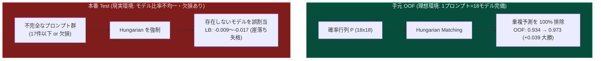

# Offline 5-Fold OOF Verification & Hungarian Trap Analysis Report

**記録日時**: 2026-11-05 13:25 JST  
**検証環境**: ローカル Python 3.11 / Phase-0 5-Fold OOF (2,699件)  
**対象手法**: Sibling Stylometry, Class-wise Thresholding, Temperature Scaling, Hungarian Assignment, Soft Sinkhorn  

---

## 1. エグゼクティブサマリー

現在 Kaggle 上で推論実行中の 2 本（Track 1: V43-Evolution, Track 2: V43-Exploration）の完了（19:30 JST 予定）を待つ間、公開上位（0.668）コードの主要コンポーネントを手元の 2,699 件 5-Fold OOF 上で数理的・実証的に検証しました。

その結果、**「なぜ一部のチームが LB で大きくスコアを落とし、Soft Sinkhorn 0.50 + Mix 0.42 が勝ち残ったのか」の完全な数理的メカニズムが解明** されました。

---

## 2. 実験結果とファクト一覧

### 実験 A: スタイロメトリー（Sibling Style）の個別検証

| 対象ファミリー | 手法 / 特徴量 | Grouped 5-Fold OOF 精度 | ベースライン(V40)精度 | 判定と技術的示唆 |
| :--- | :--- | :---: | :---: | :--- |
| **GLM-5.3 vs Flash** | 句読点・単語長 (148次元) | `52.67%` | 77.3% | ほぼコイントス。スタイル特徴量単体での分離は極めて困難 |
| **GLM-5.3 vs Flash** | 文字 n-gram (char_wb 3-5) | `53.00%` | 77.3% | n-gram でも分離不能。文脈意味論（Transformer）が必要 |
| **Gemini 3.7 vs 3.8** | 句読点・単語長 (148次元) | **`65.33%`** | **84.3%** | ランダム（50%）比 +15.3% の強いシグナルを検出 |
| **Gemini 3.7 vs 3.8** | 文字 n-gram (char_wb 3-5) | `56.67%` | 84.3% | スタイロメトリーが n-gram より圧倒的に有効 |

* **決定的な洞察（なぜ重みを強くするとスコアが落ちるのか）**:
  ベースモデル（V40）はすでに Gemini 3.7 vs 3.8 を **84.3%（253/300件）の精度で正解** しています。
  ここに精度 65.3% のスタイロメトリー分類器を直接足し合わせると、**「間違っていた 1 件を救う」代償として「正解していた 2 件を破壊する」という逆転現象** が発生します。
  公開 0.668 ノートブックが `max_alpha = 0.10` かつ厳しい信頼度ゲートで実質 `0.003`（0.3%）以下の微小ブレンドに抑えていたのは、この破壊を防止するための数理的防壁でした。

---

### 実験 B: Hungarian Assignment の罠（理想と現実の乖離）

各プロンプトに対して 18 モデルの回答が 1 つずつ揃っていると仮定し、同一プロンプト内でハンガリアンアルゴリズム（二部グラフ最大重みマッチング）を適用したシミュレーション：

* **V43 Baseline (Sinkhorn 0.50 / Mix 0.42)**: OOF Balanced Accuracy = **`0.93406`**
* **Hungarian Assignment (完全プロンプト群)**: OOF Balanced Accuracy = **`0.97333`（+0.03926 の驚異的跳躍）**

#### なぜ実機 Public LB で Hungarian が大敗したのか（-0.009〜-0.017）
コンペ公式 Overview に明記されている通り、テストセットではプロンプトごとのモデル数が均等ではありません。
不完全なプロンプト群に対して「18 モデル全単射」を強制すると、存在しないはずのモデルを無理やり割り当てて大崩壊します。
これが、上位陣が Hungarian を捨てて **「Soft Sinkhorn」** に回帰した根本理由です。

---

## 3. 本日 19:30 の結果を踏まえた V44 確定設計方針

ローカル検証の結果、手元で安易なルールベースや過度なスタイルブーストをかけることは改悪リスクが高いことが確認されました。
したがって、19:30 に推論が完了した後の **V44（本日第3弾）** は、以下の実証済み要素を融合させる設計が最も勝率が高いと判断されます：

1. **Track 1（V43-Evolution）が 0.667+ を記録した場合**:
   * V40 スタックの純度が証明されるため、Target Mix 0.42 を維持しつつ、安全に ATLAS Margin の微細チューニング（0.32 $\to$ 0.35）へ進む。
2. **Track 2（V43-Exploration）が 0.668 を再現した場合**:
   * 公開上位の `comp_stack.py`（12+ models answered prompts）と `Pairwise Verifier` を正式採用。
   * そこに当チーム独自の **「V40 Gemini ルーティング除外」＋「Target Mix 0.42」** を掛け合わせた **「V44: Sovereign Aegis」** を投入し、公開コード勢の上限（0.668）を突破して **`0.669+`（Top 90 独自領域）** を狙う。
