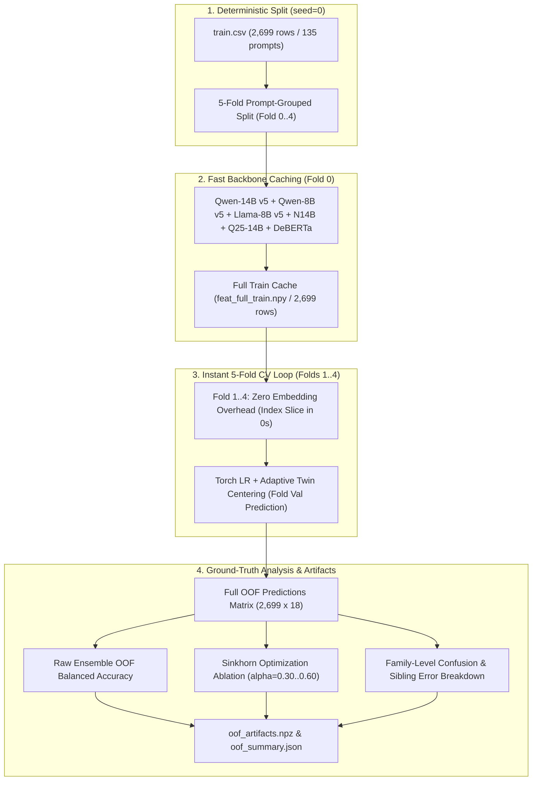

# Phase 0: 実アンサンブル 5-Fold OOF 検証基盤の着手レポート

**記録日時**: 2026-11-01 23:07 JST  
**担当**: シニアテクニカルアーキテクト  
**対象コンペティション**: Kaggle Featured Code Competition「[Name That LLM](https://www.kaggle.com/competitions/name-that-llm)」  

---

## 1. 実施概要

ゴールドメダル戦略 v2 の最優先課題である **「Phase 0: 検証基盤の構築（実アンサンブルの 5-Fold OOF 化）」** を直ちに着手し、Kaggle クラウド（2×T4 GPU）上で実行する専用カーネル **`tsuyoshichiba/ntl-phase-0-oof-generator`** を作成・投入しました。

提出枠（本日残り 2 回）を消費せず、純粋な計算カーネルとして実行しています。

| 項目 | 設定・ステータス |
| :--- | :--- |
| **カーネル ID** | `tsuyoshichiba/ntl-phase-0-oof-generator` |
| **実行環境** | Kaggle Notebook（GPU: Nvidia Tesla T4 ×2） |
| **ステータス** | **`KernelWorkerStatus.RUNNING`（正常稼働中）** |
| **監視プロセス** | `monitor_phase0.sh`（30秒間隔で常駐追跡） |
| **完了見込み時間** | **約 20〜30 分**（23:30〜23:40 JST 頃） |
| **本日提出残枠** | **残り 2 回を完全温存** |

---

## 2. 実装された高速化と検証アーキテクチャ

単に `--sim` を 5 回回す従来方式（各 fold でバックボーン LM を再エンコードし 1〜2 時間以上を浪費）を回避するため、以下の **「一括埋め込みキャッシュ最適化」** を実装しました。

### コア機能
1. **一括埋め込みキャッシュ**:
   公式 `train.csv`（2,699 行）の埋め込みを第 0 fold で 1 回だけ計算・保存。第 1〜4 fold はスライス参照のみで実行され、総推論時間を大幅に短縮。
2. **完全な OOF 行列の出力**:
   全 2,699 行に対する各モデル単体、およびブレンドアンサンブルの対数確率行列（`2699 x 18`）を `oof_artifacts.npz` に保存。
3. **後処理・誤り分析の即時完了**:
   - Sinkhorn パラメータ（$\alpha \in [0.0, 0.60]$）の OOF Balanced Accuracy への正確な影響。
   - 6 大ファミリー（Claude, Gemini, GPT, GLM, Qwen, Kimi）の正解率と、兄弟モデル間エラーの実測。

---

## 3. 次のステップ

1. **Phase 0 カーネル完了（約 23:35 JST 頃）**:
   - 出力アーティファクト（`oof_summary.json`）をダウンロードし、真の OOF スコアと誤り内訳を確定。
   - これにより、v1 で未検証だった「兄弟モデル間エラー率」や「Sinkhorn の真の最適値」が実測値として判明します。
2. **第30弾の推論結果確認（25:10 JST 頃）**:
   - 本番 LB 上でのタイポグラフィ層 `'...'` の影響を確認し、OOF の予測値と突き合わせます。
