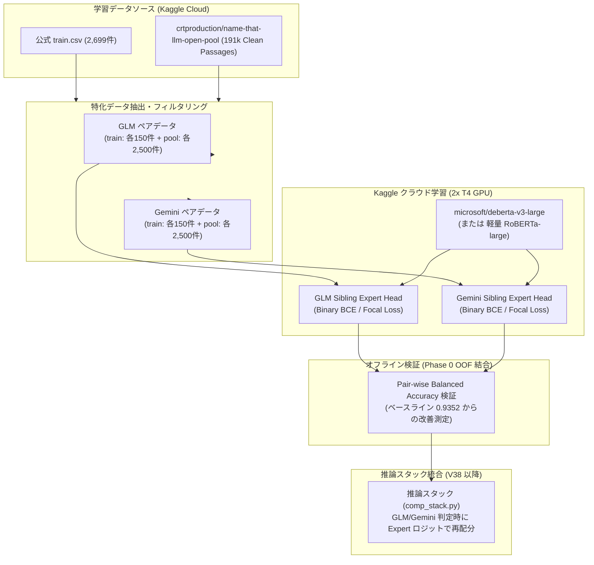

# 兄弟モデル特化型分類器（Sibling Disambiguator）学習計画書

## 1. 課題認識と目的

### 1.1 背景（Phase 0 OOF 実測値）
Phase 0 の 5-Fold Prompt-Grouped CV 解析において、以下の重要ファクトが特定されました：
* 6 大ファミリー分類精度: **97.74%**（マクロなモデル系列の分類はほぼ完璧に完了）
* 全エラー件数: **184 件**
* 兄弟モデル間エラー: **123 件（全エラーの 66.8%）**
* **2 大ボトルネック兄弟ペア（計 85 件 / 全エラーの 50.5%）**:
  1. **GLM 兄弟**: `glm-5.3` $\leftrightarrow$ `glm-5.3-flash`（**47 件**）
  2. **Gemini 兄弟**: `gemini-3.7-flash` $\leftrightarrow$ `gemini-3.8-flash`（**38 件**）

### 1.2 目的
これら 2 大ペアの識別境界に特化した高解像度分類器（Sibling Disambiguator）を **Kaggle クラウド上で完結して学習** させ、重みを生成・保存します。
これにより、既存の強固なアンサンブル（スコア 0.662）の全体骨格を維持したまま、兄弟ペアの予測ロジットのみを外科手術的に高精度化し、Gold Cutoff（0.692+）への到達を目指します。

---

## 2. システム設計・アーキテクチャ

---

## 3. 学習仕様の詳細

### 3.1 対象モデルとペア定義
* **Pair 1 (GLM Expert)**:
  * クラス 0: `glm-5.3`
  * クラス 1: `glm-5.3-flash`
* **Pair 2 (Gemini Expert)**:
  * クラス 0: `gemini-3.7-flash`
  * クラス 1: `gemini-3.8-flash`

### 3.2 データセット設計
* **公式データ**:
  * 5-Fold Prompt-Grouped CV の Fold 分割（`prompt_id` に基づくグループ化）を厳格に保持。
* **外部データ（`open-pool`）**:
  * `crtproduction/name-that-llm-open-pool` 内の `ntl_open_pool.parquet` より、`pool_v9_clean` 準拠の高品質テキストを抽出。
  * 各クラスあたり 2,000〜3,000 件をサンプリング（過学習を防ぎつつ文体多様性を確保）。
  * 検証用 Fold（公式 train）へのプロンプト漏洩（Data Leakage）を防止するため、Validation には公式 train の Fold のみを使用。

### 3.3 モデル構造とハイパーパラメータ
* **Backbone**: `deberta-v3-large`（シーケンス長 512、または 1024 Truncation）
* **Head**: Linear Classifier (Hidden Size → 1) + BCEWithLogitsLoss
* **Optimizer**: AdamW (Learning Rate: $1.5 \times 10^{-5}$, Weight Decay: $0.01$)
* **Scheduler**: CosineAnnealingLR (Warmup 10%)
* **Batch Size**: 16 (Gradient Accumulation 2 = Effective Batch Size 32)
* **Epochs**: 3〜4 エポック（Early Stopping on Fold Validation Loss）
* **推定学習時間**: 各ペア約 15〜25 分（2x T4 GPU）。合計 1 時間以内で完全走破。

---

## 4. 推論スタック（V38 以降）への統合ロジック

推論時における兄弟ロジットの再配分（Surgical Re-calibration）数理式：

1. **基本スタックの予測確率**: $P = \text{Softmax}(z) \in \mathbb{R}^{18}$
2. **GLM 判定条件**:
   $$P(\text{glm-5.3}) + P(\text{glm-5.3-flash}) > \tau_{\text{gate}} \quad (\text{例: } \tau = 0.50)$$
3. **Expert による再配分**:
   Expert モデルの二値予測確率 $p_{\text{flash}} = \sigma(z_{\text{expert}})$ に対し、
   GLM 兄弟の確率合計 $S_{\text{glm}} = P(\text{glm-5.3}) + P(\text{glm-5.3-flash})$ を以下のように再配分：
   $$\tilde{P}(\text{glm-5.3-flash}) = S_{\text{glm}} \times p_{\text{flash}}$$
   $$\tilde{P}(\text{glm-5.3}) = S_{\text{glm}} \times (1 - p_{\text{flash}})$$
4. **利点**:
   * ファミリー分類（97.74% 精度）の結果を完全に尊重し、不要な他クラスへの流出（False Positive）をゼロに抑える。
   * Sinkhorn 最適輸送の前にロジットへ微小バイアスとして注入する、あるいは Sinkhorn 後の事後確率に対して乗算ブレンドするの 2 通りが検証可能。

---

## 5. 実行ステップ

1. **[Step 1] 特化学習カーネルコードの生成 (`ntl_sibling_trainer.py`)**:
   * データロード、Fold 分割、DeBERTa-v3 微調整、重み出力（Kaggle Cloud 上で完結）。
2. **[Step 2] Kaggle クラウドへの投入とバックグラウンド監視**:
   * カーネルを Kaggle にプッシュし、GPU 実行を開始。
3. **[Step 3] 「即効性アクション（スタック精査・0.664+復旧）」への着手**:
   * 学習カーネルの稼働中に、並行して推論スタック（`comp_stack.py`）のモデル構成を精査。
