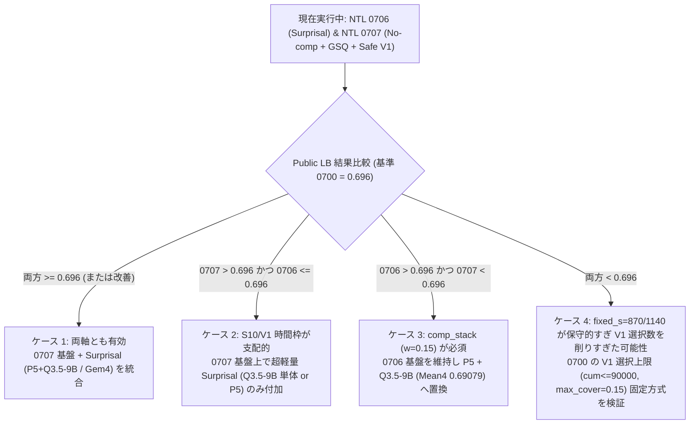

# 次期検証方針書（2026-11-18）

## 1. 現在の提出ステータスと進行中の 2 軸実験

現在（`2026-11-18` UTC 枠、残り **`3 / 5`** 枠）、自己ベスト [`NTL 0700` (`0.696`)](file:///Users/echo/kaggle/name-that-llm/submission_0700_0684_v1_graft_safe/ntl-0700-0684-v1-graft-safe.ipynb) に対する独立した 2 軸の切り分け実験が `PENDING`（再実行中）となっています。

| Sub ID | ノートブック | 検証軸（vs `NTL 0700: 0.696`） | 主な設定・修正点 | Status |
| :--- | :--- | :--- | :--- | :---: |
| **`58490392`** | [`NTL 0706`](file:///Users/echo/kaggle/name-that-llm/submission_0706_v1_surprisal_p5_gemma4_clean/ntl-0706-surprisal-p5-gemma4-clean.ipynb) | **軸 A：Surprisal 純粋加算** | `0700` S10 維持 + `P5+Gem4-12B (kNN 2,0.20)` + `SPEC` 削除 + `V1_COST (870/1140)` | `PENDING` |
| **`58490991`** | [`NTL 0707`](file:///Users/echo/kaggle/name-that-llm/submission_0707_baseline_nocomp_gsq_v1/ntl-0707-baseline-nocomp-gsq-v1.ipynb) | **軸 B：S10/V1 基盤刷新** | `comp_stack` 無効 (`comp_w=0`) + `GSQ 27B (6.3h)` & `Native (7.2h)` 完走化 + `V1_COST (870/1140)` | `PENDING` |

---

## 2. ローカル OOF 追加ベンチマーク結果の総括

本番 [`infer.py`](file:///Users/echo/kaggle/name-that-llm/submission_0700_0684_v1_graft_safe/ntl-0700-0684-v1-graft-safe.ipynb) と同じ「Typography 補正なしの `Raw S10 proxy`（Sinkhorn バランスのみ）」を基準に、5-Context GroupKFold（`full`, `mix1-4`, `s2_real`, `singleton`、疎コンテキストは 15 回反復）で計測した結果は以下の通りです。

### 2.1 Surprisal モデル組合せ比較（`kNN k=2, tau=0.20`）

| # | Surprisal 構成（すべて `Raw S10 proxy` 上） | Mean4 | `full` | `mix1-4` | `s2_real` | `sing` | 9h 予算上の特徴 |
| :-: | :--- | :---: | :---: | :---: | :---: | :---: | :--- |
| 0 | **Base (`Raw S10 proxy`)** | `0.68437` | `0.70462` | `0.69430` | `0.68619` | `0.65237` | 追加推論 0 分 |
| 1 | `P5: Q3-4B + Q25-7B (60D)` [`0702`] | `0.68981` | `0.70907` | `0.70130` | `0.69504` | `0.65386` | 既マウント・軽量（約18〜20分） |
| 2 | `Gem4-12B only (30D)` | `0.68888` | `0.71240` | `0.69731` | `0.69269` | `0.65311` | 単体 1 モデル（約15〜18分） |
| 3 | `Q3.5-9B only (30D)` | `0.68948` | `0.71166` | `0.69829` | `0.69411` | `0.65386` | **既マウント単体で `+0.00511`** |
| 4 | `Q25-7B + Gem4-12B (70D pair)` | `0.68980` | **`0.71685`** | `0.69652` | `0.69233` | `0.65348` | 2 モデル（`0706` Stage 2 フォールバック） |
| 5 | `P5 + Gem2-9B (90D)` [`0703/0704`] | `0.69020` | `0.71129` | `0.69975` | `0.69367` | **`0.65608`** | `Gem2` は `eager` 必須でやや低速 |
| 6 | **`P5 + Gem4-12B (90D)` [`0706`]** | `0.69020` | `0.71314` | `0.69911` | `0.69506` | `0.65348` | 現在 `58490392` で検証中 |
| 7 | **`P5 + Q3.5-9B (90D)`** | **`0.69079`** | `0.71240` | **`0.70034`** | **`0.69656`** | `0.65386` | **Mean4 最高・すべて `0700` 既マウント** |
| 8 | **`Q25-7B + Gem4 + Q3.5-9B (90D)`** | **`0.69076`** | `0.71536` | `0.69976` | `0.69478` | `0.65311` | 90D 中 `full` 最高 |
| 10 | **`P5 + Q3.5-9B + Gem4 (120D)`** | **`0.69072`** | `0.71462` | `0.69914` | `0.69528` | `0.65386` | 4 モデルフル構成 |

### 2.2 棄却・不採用が確認された要素（リスク管理）

> [!IMPORTANT]
> 以下の要素はローカル OOF（特に疎コンテキスト `mix1-4` / `s2_real`）で一貫して悪化または無反応であったため、今後の提出パイプラインには組み込みません。

1. **`Apex V4` 後処理（`PngyResidual` + `prompt_pair_adjustment` + `TypoRules(0.15)`）**:
   - `Raw S10 proxy` 上で `Mean4 0.68437 -> 0.68213 (-0.00224)`、`full -0.00373 (P=0.020)` と統計的に有意に悪化。
2. **`kirilltym` の `StyleLanguageModel(w=0.22)`**:
   - `full` のみ `+0.00252` だが、`mix1-4 (-0.00449)` / `s2_real (-0.00298)` で崩れ、`Mean4 0.68315 (-0.00122)`。
3. **Surprisal での `GPT` / `Claude` / `Gemini 4-class` 条件付きヘッド追加**:
   - `P5+Q35+Gem4`（`Mean4 0.69072, s2_real 0.69528`）に対し、`+ GPT(0.10)` は `full 0.71832` へ伸びる一方 `s2_real 0.69179` へ低下（`Mean4 0.69027`）、`+ Claude(0.10)` は `Mean4 0.68899`。現行の **`all18 (frac=0.08) + GEM_IDX (0.25) + GLM_PAIR_IDX (0.15)`** が疎コンテキスト耐性で最も安定しています。

---

## 3. `NTL 0706` / `NTL 0707` 結果確定後の判断マトリクス

---

## 4. 次期検証候補（残り `3 / 5` 枠の活用案）

### 候補 1：`NTL 0708` — `0707` 基盤（`comp_stack` 無効 + `GSQ 27B` 完走）+ `P5 + Qwen3.5-9B -> Gemma-4-12B` Surprisal
- **狙い**:
  - `NTL 0707` では `comp_stack.py`（約 45〜60 分以上）をスキップしているため、`0700` / `0706` と比較して **約 1 時間の余裕** が生まれます。
  - その余剰時間を使えば、**`V1` の時間枠（`~1.7h〜2.0h`）を一切削ることなく**、OOF 最高スコアの **`P5 + Qwen3.5-9B (Mean4 0.69079)`**（さらに時間があれば `+ Gemma-4-12B` の 120D）を完走させられる見込みがあります。
- **メリット**:
  - `bbucxi/qwen35-9b-safetensors` は既に `0700` / `0707` にマウント済みであり、`Qwen3.5-9B` + `Qwen2.5-7B` + `Qwen3-4B` の 3 モデル構成なら `Gemma-4-12B` よりもメモリ・推論時間ともに軽く、4段フォールバック（`Q3.5-9B (30D) -> Q25+Q3.5 (70D) -> P5+Q3.5 (90D) -> P5+Q3.5+Gem4 (120D)`）を組むことができます。
- **リスク・制約事項**:
  - `NTL 0707` の結果が出る前に投入する場合、万一 `comp_stack (w=0.15)` の除外自体が LB でマイナスだった場合にその影響を共有します。

### 候補 2：`NTL 0709` — `lightningv08` 型 固定トークン上限 `V1`（`cum <= 90000, max_cover = 0.15`）の切り分け検証
- **狙い**:
  - `NTL 0706` / `0707` では `--deadline-mono` と `fixed_s_flash=870, fixed_s_glm53=1140` による動的選択を用いていますが、`lightningv08 (0.702)` の `v1_stage.py` は `--deadline-mono` を使わず **`n_sel = min(int((cum <= 90000).sum()), int(0.15 * len(ids)))`** という固定トークン上限（約 90k トークン・最大 15%）で `V1` を実行しています。
- **メリット**:
  - 実行開始時刻の揺らぎによらず、常に同一の `V1` カバレッジ（上位 15% / 90k トークン）が再現性高く適用されます。
- **リスク・制約事項**:
  - 前段（S10 + Surprisal）が `7.2h` を大きく超えた場合、`--budget-s` による途中打ち切りがないため 9h ハードリミットに接近するリスクがあります（導入時は前段のデッドラインを `7.0h` 以下に厳格固定する必要があります）。

### 候補 3：`NTL 0710` — `0706` 基盤での `P5 + Qwen3.5-9B (90D)` 置換（`comp_stack` 維持ルート）
- **狙い**:
  - `0700` の `S10`（`comp_stack` 込み）を維持したまま、Surprisal を `Gemma-4-12B (12B)` からより高速かつ OOF `Mean4` が高い **`Qwen3.5-9B + Qwen2.5-7B + Qwen3-4B (90D, Mean4 0.69079)`** に置き換え、`V1` の残り時間をさらに約 8〜10 分拡大します。
- **メリット**:
  - `0700 (0.696)` からの変更リスクが最小で、`Gemma-4-12B` よりも軽量かつ疎コンテキスト（`mix1-4: 0.70034`, `s2_real: 0.69656`）に強い特徴量を使えます。
- **リスク・制約事項**:
  - `comp_stack` を維持するため、抜本的な時間短縮（1時間単位）にはならず、`SURPRISAL_DEADLINE_H = 7.35` 前後での運用となります。

---

## 5. 推奨スケジュール（本日残り `3 / 5` 枠の配分）

1. **即時〜先行準備（枠消費なし）**:
   - **候補 1（`P5 + Qwen3.5-9B (+ Gem4)` 4段階フォールバック重みパック＋検証）** をローカルで作成・単体テストまで完了させておく。
2. **提出枠の使い分け**:
   - **方針 1（先行投入）**: `NTL 0706` / `0707` は完了まで約 7〜8 時間かかるため、待ち時間を活かして **候補 1（`NTL 0708`: `0707` 基盤 + `Q3.5-9B / P5` Surprisal）** を本日 3 本目として今からビルド・スモーク検証・提出し、残り **`2 / 5` 枠** を `0706` / `0707` の結果確認後の最終調整用に温存する。
   - **方針 2（結果確認待ち）**: まず `0706` と `0707` のスコアが出るまで提出枠 `3 / 5` をすべて温存し、ローカル準備のみ進める。
