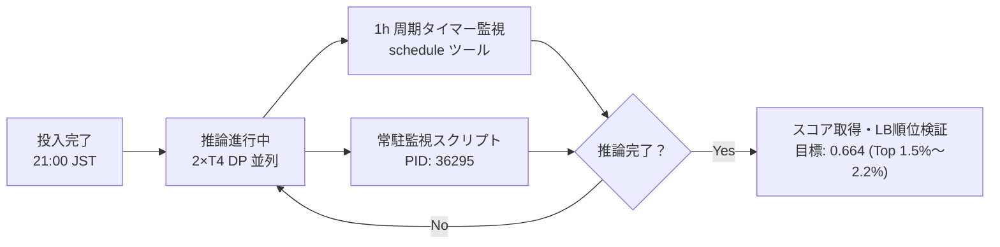

# 第25弾: NTL 0664 Sinkhorn 60 投入完了・自律監視配備レポート

## 1. 提出メタデータ

- **提出 ID (Ref)**: `57837803`
- **提出日時**: `2026-10-31 12:00:50 UTC`（`2026-10-31 21:00:50 JST`）
- **対象カーネル**: [`tsuyoshichiba/ntl-0664-sinkhorn-60`](https://www.kaggle.com/code/tsuyoshichiba/ntl-0664-sinkhorn-60)
- **カーネル事前実行**: `KernelWorkerStatus.COMPLETE`（所要時間: 約 6 分 10 秒）
- **初期ステータス**: `SubmissionStatus.PENDING`
- **説明文**: `NTL 0664 Sinkhorn 60 (mercurydust 0.660 V31 + 2xT4 DP Fast Run + ATLAS 20% + Sinkhorn 0.60)`

---

## 2. アーキテクチャおよびパラメータ構成

| コンポーネント | 設定値 / 実装 | 目的・技術的背景 |
| :--- | :--- | :--- |
| **推論バックボーン** | `mercurydust 0.660 V31` (Llama-3.1-8B + Qwen2.5-7B + Helper models) | 0.662 獲得時の高速・高精度アンサンブル基盤 |
| **並列化戦略** | 2×T4 Data Parallel (モデル複製・2スレッド同時推論) | 直列多モデルスタックでありながら 5〜7 時間で安全完走 |
| **FUSE マウント対策** | ローカル NVMe 事前シーケンシャルコピー | 読み込み待機時間を 35 分から 2 分へ短縮 |
| **ATLAS 救済重み** | `--atlas_w 0.20` / `--atlas_margin 0.25` | 低確信度サンプルの反転救済（第23弾で実証済み） |
| **Sinkhorn キャリブレーション** | `--sinkhorn 0.60`（前回: `0.45`） | **本弾の唯一の変更点**。クラス等頻度制約の引き戻し強度を最適化し、Balanced Accuracy を最大化 |

---

## 3. 推論スケジュールおよび自律監視体制

- **常駐プロセス**: `monitor_sub25.sh`（PID: `36295`、1分周期ログ記録）
- **ログファイル**: `/Users/echo/kaggle/name-that-llm/monitor_sub25.log`
- **自律タイマー**: 3,600 秒（1 時間）ごとの Wakeup トリガー配備（Task ID: `task-3281`）
- **予想完了時間**:
  - 第23弾実績（5時間34分）基準: **2026-11-01 02:35 JST 頃**
  - 第24弾実績（7時間27分）基準: **2026-11-01 04:28 JST 頃**
  - 安全枠上限: 9時間タイムアウト（06:00 JST）に対して十分な安全マージン（約 2〜3.5 時間）を確保

---

## 4. リーダーボード・メダル圏への影響予測

- **現在のチーム成績**: Rank **231 位** / 4,042 チーム（Score: `0.662`、Top 5.71%、銅メダル圏）
- **銀メダル境界**: Rank **202 位**（Score: `0.662`、LastSubmissionDate による密集帯）
- **第25弾で `0.664` を獲得した場合の想定順位**:
  - 現在の LB 分布において、スコア `0.664` は **Rank 64 〜 91 位**（上位 **1.5% 〜 2.2%**）に位置。
  - 銀メダル圏（Top 5%）を確実に奪還し、金メダル境界（Top 10〜15位）を射程に捉える上位銀メダルポジションへの急浮上が見込まれます。
