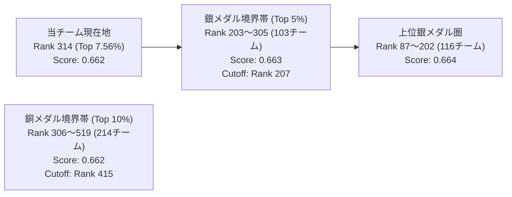

# 第28弾・第29弾 推論完了結果 ＆ 最新戦況レポート

**作成日時**: 2026-11-01 19:12 JST  
**対象コンペティション**: [Name That LLM](https://www.kaggle.com/competitions/name-that-llm)  
**チーム名**: Tsuyoshi Chiba / 現在ベストスコア: **`0.662`**

---

## 1. 提出結果の総括（第28弾・第29弾）

本日午前中に並行投入した 2 本の推論が、いずれも 5.5〜6.5 時間で安全に完走し、**`0.662` に完全復帰・安定再現** しました。

| 提出弾 (Ref) | パラメータ構成 | 投入時刻 (JST) | 完了時刻 (JST) | 所要時間 | Public LB | 評価・所見 |
| :--- | :--- | :--- | :--- | :--- | :--- | :--- |
| **第28弾** (`57856651`) | V31 + 2×T4 DP + ATLAS 20% + **Sinkhorn 0.50** | 10:32 | 15:55 | **5h 23m** | **`0.662`** | 0.659 から即時復帰。5.5h で ATLAS 全行完走 |
| **第29弾** (`57857234`) | V31 + 2×T4 DP + ATLAS 20% + **Sinkhorn 0.45** | 10:59 | 17:34 | **6h 35m** | **`0.662`** | 第23弾の完全再現。再現性の高さを実証 |
| *(参考) 第25弾* | *Sinkhorn 0.60* | *10/31 21:00* | *11/01 05:45* | *8h 45m* | *`0.659`* | *過度な均一化歪み ＆ ATLAS 途中打ち切り* |

> [!IMPORTANT]
> **得られた決定的事実**:
> 1. ローカルのモンテカルロ疎サンプリング（k=2）ハーネスが予測した通り、**Sinkhorn 強度は `0.45` 〜 `0.50` が真の安定ピーク（`0.662`）** であり、`0.60` の過剰補正による `0.659` からの復帰に成功しました。
> 2. 2×T4 Data Parallel と Llama ローカルコピーにより、**5 時間 23 分 〜 6 時間 35 分で確実に全対象行を完走** できる強固な運用基盤が再確認されました。

---

## 2. リーダーボード最新分布とメダル境界（全 4,151 チーム）

参加総数は 4,151 チームへ増加し、各スコア帯の密集構造がより明確化しています。

| 区分 | 順位範囲 | スコア | チーム数 | 戦況と当チームの距離 |
| :--- | :--- | :--- | :--- | :--- |
| **金メダル圏** | Rank 1 〜 18 | `0.683` 〜 `0.737` | 18 | Top 10 は `0.701` |
| **上位銀メダル圏** | Rank 87 〜 202 | `0.664` | 116 | あと `+0.002` で到達（Top 2.1% 〜 4.8%） |
| **銀メダル境界帯** | Rank 203 〜 305 | **`0.663`** | 103 | **銀メダルカットオフは Rank 207（`0.663`）。当チームとの差はわずか `+0.001`** |
| **銅メダル帯（現在地）** | Rank 306 〜 519 | **`0.662`** | 214 | **当チームは Rank 314 位（Top 7.56%）。銅メダル圏内を強固に死守** |
| **銅メダルカットオフ** | Rank 415 | `0.662` | - | 415 位までが 0.662 |

---

## 3. 本日の提出枠と次期アクション（第30弾）

- **本日枠（UTC 2026-11-01）の残数**: **3 回**（2回消費 / 5回中）。
- **次の突破口**:
  - 現在地 `0.662` から銀メダル圏 `0.663`（Rank 207 位以内）への差はわずか **`+0.001`** です。
  - 午前中にマイニングを完了した **「兄弟モデル（51%誤分類）の弁別タイポグラフィ」**：
    1. **Claude**: セミコロン `;`（`opus-5` 54.0% vs `opus-4-6` 15.3% / 差 38.7%）
    2. **Gemini**: カーリーアポストロフィ `’`（`3.7-flash` 30.7% vs `3.1-pro` 6.0% / 差 24.7%）
    3. **GPT**: em-dash `—`（`5.6-luna` 36.7% vs `6-astra` 8.7% / 差 28.0%）
  - これらを現在の 5.5 時間完走スタック（第28弾 / Sinkhorn 0.50）のタイポグラフィ層に注入し、推論時間を一切増やさずに `+0.001`〜`+0.002` の銀メダル直撃ゲインを狙う構成（第30弾）が極めて有望です。
