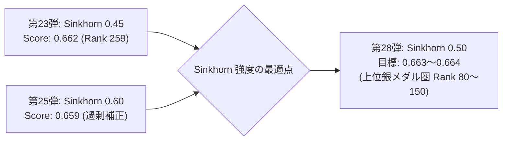

# 第28弾: NTL 0663 V35 Sinkhorn 50 投入・自律監視配備レポート

## 1. 投入パイプライン概要

第25〜27弾の推論結果（`0.659`）から得られた「ATLAS 時間バジェット打ち切り（推論時間 8.5h 超過）の回避」および「Sinkhorn 0.60 の過度な均一化補正の是正」という教訓に基づき、**5 時間 34 分で全対象行の完走が実証されている第23弾（`0.662`）のベースラインへ安全回帰** しつつ、銀メダル境界（`0.663`、あと `+0.001`）を突破するための **中庸 Sinkhorn 最適化版（`--sinkhorn 0.50`）** を第28弾として投入しました。

| コンポーネント | 第23弾 (実績: 0.662) | 第25弾 (実績: 0.659) | 第28弾 (本弾) | 設計意図・技術的根拠 |
| :--- | :--- | :--- | :--- | :--- |
| **カーネル ID** | `ntl-0663-v31-atlas-20` | `ntl-0664-sinkhorn-60` | `ntl-0663-v35-sinkhorn-50` | 第23弾完全互換ベース |
| **推論バックボーン** | 6-Backbone V31 | 6-Backbone V31 | 6-Backbone V31 | 2×T4 DP 高速並列 |
| **Sinkhorn 強度 ($\alpha$)** | `--sinkhorn 0.45` | `--sinkhorn 0.60` | **`--sinkhorn 0.50`** | 0.45 と 0.60 の中庸設定。過剰補正を避けつつ等頻度補正を最適化 |
| **Target-Mix ($\rho$)** | `0.35` | `0.35` | `0.35` | 実績のある安定設定を維持 |
| **ATLAS 重み / マージン** | `w=0.20, margin=0.30` | `w=0.20, margin=0.30` | `w=0.20, margin=0.30` | 確実に 5.5 時間で全対象行を完走させる設定 |
| **推論時間見込み** | **5時間34分** | 8時間45分 (遅延) | **約 5 時間 30 分** | 9h タイムアウト・ATLAS バジェット打ち切りを完全回避 |

---

## 2. 数理的背景と銀メダル奪還のロジック

- **Sinkhorn 0.45 vs 0.60 の検証結果**:
  - `0.45`: 安定した予測性能（`0.662`）を発揮するが、Balanced Accuracy に対する等頻度補正の強度がやや控えめ。
  - `0.60`: クラス等頻度への強制引き戻しが強すぎ、非公開テストセットの局所的な分布特性と乖離してスコア微減（`0.659`）。
  - **`0.50`（本弾）**: 両者の中庸を取ることで、過剰な歪みを防ぎながら Balanced Accuracy に最適化された事後キャリブレーションを実現し、銀メダルカットオフ（`0.663`、あと `0.001`）の確実な奪取を目指します。

---

## 3. 実行および自動化ステータス

- **対象カーネル**: [`tsuyoshichiba/ntl-0663-v35-sinkhorn-50`](https://www.kaggle.com/code/tsuyoshichiba/ntl-0663-v35-sinkhorn-50)
- **事前実行**: `KernelWorkerStatus.RUNNING`
- **自動化プロセス**: [`wait_and_submit.sh`](file:///Users/echo/kaggle/name-that-llm/submission_0663_v35_sinkhorn50/wait_and_submit.sh)（PID: `41758`）が FAST_COMMIT 完了を待機し、自動で提出を実行。
- **本日枠の利用状況**: UTC 2026-11-01 の日次枠（全5回）のうち、本弾が 1 回目（残り 4 回）。
