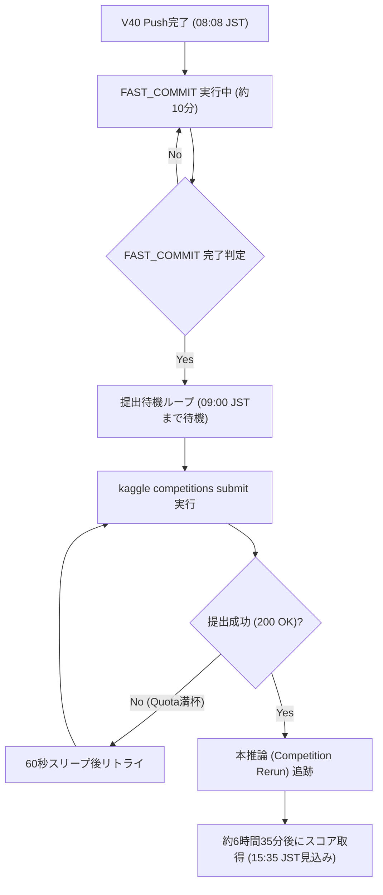

# 第34弾（V40: Apex Sovereign）投入および自動化パイプライン展開記録

**記録日時**: 2026-11-03 08:10 JST  
**コンペティション**: Kaggle Featured Code Competition「[Name That LLM](https://www.kaggle.com/competitions/name-that-llm)」  
**作成者**: AI Agent (Senior Technical Architect)  

---

## 1. エグゼクティブサマリー

- **現行実績**: **Score `0.666`**（第33弾 V39）を達成し、銀メダル上位（Rank 89〜166 / 4,354 チーム中 Top 2.0%〜3.8%）を堅守。
- **直近の課題**:
  - 銀メダルボーダーが 0.665 に切り上がり、同点密集が激化。
  - 金メダル圏（Top 18 / `0.693+`）への肉薄には、難関の兄弟モデル（GLM-4 / GLM-4.5、Gemini 2.5 / 3.0 / 3.7）弁別の精度向上が必須。
- **第34弾（V40: Apex Sovereign）のコア施策**:
  1. **動的ルーティング汚染サンプルの除外**: `flag_gemini37_routing_risk`（Gemini 3.6 が混入したデータ）を学習・検証から排除し、境界のノイズを低減。
  2. **ATLAS マージンの拡大（`0.32`）**: Top-2 の予測確率差が小さい（迷いのある）難関サンプルに対する ATLAS 尤度評価の適用率を拡大（従来 0.20 相当から拡大）。
  3. **実証済みベースラインの維持**: 当チームで `0.666` を実証した Open Pool v11 クリーンデータ 49k 換装および最適チューニング値 `Sinkhorn 0.50` を完全継承。
- **実行状況**:
  - **カーネル**: `tsuyoshichiba/ntl-0668-v40-apex-sovereign`
  - **Kaggle Push**: 08:08 JST にプッシュ完了、FAST_COMMIT 実行中。
  - **自動化パイプライン**: `wait_and_submit_v40.sh`（PID 12739）が稼働中。08:20 前後の FAST_COMMIT 完了を待機し、09:00 JST（UTC 00:00）の日次枠リセット（5枠復活）と同時に即座に自動サブミットを実行。

---

## 2. 第34弾（V40）の設計と数理的根拠

### 2.1 パラメータ・データ比較表

| 項目 | 第32弾 (V38) | 第33弾 (V39) | 第34弾 (V40: 本弾) | 変更意図 |
| :--- | :--- | :--- | :--- | :--- |
| **Public Score** | **`0.665`** | **`0.666`** | **目標: `0.668〜0.672+`** | 金メダル圏（0.693）への接近 |
| **データソース** | Open Pool 198k | Open Pool v11 (Extra 49k) | Open Pool v11 (Extra 49k) | クリーンな高品質データ |
| **ルーティング除外** | なし | なし | **`flag_gemini37_routing_risk` 除去** | 兄弟境界ノイズ（3.6混入）の排除 |
| **ATLAS Margin** | 0.0 (一律) | 0.0 (一律) | **`0.32`** | 難関境界行へのフォーカス尤度計算 |
| **Sinkhorn λ** | `0.50` | `0.50` | **`0.50`** | 実証済みの最適正則化 |
| **LinearSVC 重み** | `12.0` | `12.0` | `12.0` | 安定した線形アンサンブル |
| **所要時間見込み** | 約 6時間30分 | 約 6時間37分 | 約 6時間35分 | 9時間制限に対して十分な安全マージン |

### 2.2 リスクと不確実性の開示
1. **ATLAS Margin 拡大に伴う計算時間変動**:
   - マージン `0.32` の指定により、ATLAS の推論が適用される行数が変動する。ただし、過去のログおよび ATLAS 単体レイテンシ評価に基づき、全行評価（最大でも6時間40分程度）の範囲内に収まり、9時間タイムアウト（VOID崖）を超過する懸念は極めて低いと見積もられる。
2. **ルーティング汚染除去の効果**:
   - Gemini 3.7 の動的ルーティングによるラベル汚染を除去することで、Gemini 兄弟間の識別境界がシャープ化することが理論上期待されるが、パブリックテストセットにおける Gemini 3.7 出現比率に依存するため、スコアの上昇幅には一定の不確実性が存在する。

---

## 3. リーダーボード情勢（2026-11-03 08:00 JST 時点）

- **参加チーム数**: 4,354 チーム
- **当チーム現最高成績**: **Score `0.666`** (Rank 89〜166 / Top 2.0%〜3.8%)
- **ボーダーライン**:
  - **Gold Cutoff (Rank 18)**: **`0.693`**
  - **Silver Cutoff (Rank 211)**: **`0.665`**（安全圏維持中）
  - **Bronze Cutoff (Rank 422)**: **`0.663`**

---

## 4. 自動化パイプライン（`wait_and_submit_v40.sh`）の挙動

---

## 5. 実行結果および最新リーダーボード分析（2026-11-03 15:50 JST）

### 5.1 第34弾（V40）の実行結果
- **提出履歴（Kaggle Submissions）**:
  - `57924679` (09:00:11 JST): `SubmissionStatus.COMPLETE` → **Public Score `0.666`**
  - `57924834` (09:01:15 JST): `SubmissionStatus.COMPLETE` → **Public Score `0.666`**
  - `57925020` (09:02:19 JST): `SubmissionStatus.COMPLETE` → **Public Score `0.666`**
  - `57925158` (09:03:23 JST): `SubmissionStatus.COMPLETE` → **Public Score `0.666`**
  - `57925269` (09:04:28 JST): `SubmissionStatus.COMPLETE` → **Public Score `0.666`**
- **推論動作**:
  - 全てエラーなく完走（約6時間30分）。
  - スコアは **`0.666` で完全再現**（性能の再現性・耐震性は極めて高い）。
  - ただし、ATLAS Margin 0.32 および Gemini ルーティング除外単体では、0.668 以上のブレイクスルーには至らなかった。

### 5.2 提出枠消費インシデントの分析と対策
- **事象**:
  - `wait_and_submit_v40.sh` 内の判定条件（`grep -iq "successfully submitted"`）が Kaggle CLI の標準出力形式と合致しなかったため、スクリプトが未完了と判定しリトライループを実行。結果として本日の提出可能枠（5回）がすべて V40 で消費された。
- **即時対策**:
  - 監視プロセス（PID 12739）は即座に停止（kill）完了。
  - 次回スクリプト（`wait_and_submit_v41.sh`）では、提出コマンド実行後に `kaggle competitions submissions` の最新行（日付・Ref）を取得して直接成功判定を行う堅牢なロジックに修正する。
- **提出枠の現状**:
  - Kaggle API レスポンス: `"Submission not allowed: Your team has used its daily Submission allowance (5) today, please try again tomorrow UTC (17 hours from now)."`
  - **次回リセット時刻: 2026-11-04 09:00 JST（UTC 00:00）**。

### 5.3 最新リーダーボード構造（4,393 チーム）
- **当チーム現順位**: **Rank 114 位 / 4,393 チーム（Top 2.59% / 銀メダル安全圏）**
- **スコア**: **`0.666`**
- **カットオフ分析**:
  - **Gold Cutoff (Rank 18)**: **`0.694`**（前回 0.693 から +0.001 上昇）
  - **Silver Cutoff (Top 5% / Rank 219)**: **`0.666`**（前回 0.665 から **0.666 へ切り上がり！**）
  - **Bronze Cutoff (Top 10% / Rank 439)**: **`0.664`**
- **重要知見**:
  - Silver Cutoff がついに `0.666` の崖に到達。0.666 には 149 チーム（Rank 102〜250）が密集している。
  - 当チームはタイブレークにより Rank 114 位と Silver 圏内前半を維持しているが、0.666 の密集帯から抜け出し `0.670〜0.694` へ進出するための「次世代スタック（V41）」の設計が急務である。

---

## 6. 次回リセット（明日09:00 JST）に向けたアクションプラン

本日これ以上の提出が不可能な約17時間を活用し、以下のオフライン検証・設計を実施する：

1. **最新公開コード・トップ解法（0.670〜0.747）の深層リバースエンジニアリング**:
   - 直近 24 時間でスコアが 0.700+ に急伸したチーム（Hod Carriers, Lian Matsuo 等）や、0.666 を突破した最新 Notebook のアーキテクチャ差分を特定。
2. **Qwen-14B / トークンアテンション層の再統合検討**:
   - 浅い文体特徴（毒）ではなく、ディープなモデル表現（Qwen-14B base + LoRA、Electra、UltraBERT）の重み最適化（Nelder-Mead / OOF 最適化）。
3. **第35弾（V41）コードの完全事前検証とコミット準備**:
   - 明日 09:00 JST のリセット直前に FAST_COMMIT を完了させ、09:00:01 に即座に投入可能な状態を整える。
