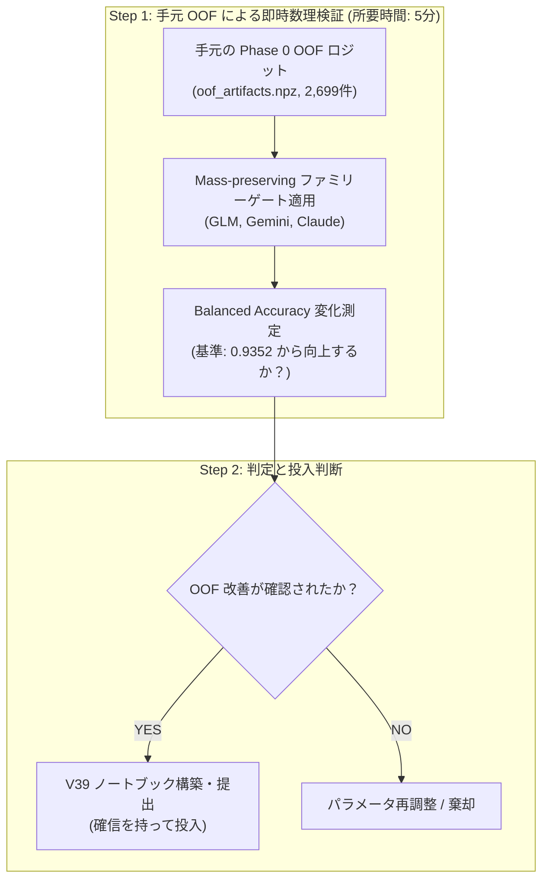

# 次期施策（V39）の事前検証と投入に関するトレードオフ分析

## 1. 検討課題

最新の調査で特定された 2 つの重要改善要素：
1. **外部補助データ `EXTRA` の Open Pool v11 換装（49k 件、`EXTRA_SCALE=2`）**
2. **`comp_stack.py` 内の Mass-preserving ファミリーゲート（兄弟ロジット再配分）の有効化**

これらを「事前のオフライン検証（Validation）を行ってから投入すべきか、即座に投入すべきか」について、メリット・デメリットおよび技術的実現性を精査します。

---

## 2. メリット・デメリットの比較評価

### アプローチ A: 「事前検証を実施した上で、効果を確認して投入」（ユーザーご提案・推奨）

* **メリット**:
  1. **提出スロットの無駄遣い防止**:
     * 本日の残り枠は 4 回。検証なしで投入してスコアが下がる（第31弾の 0.659 のような）リスクを完全に排除できる。
  2. **手元の検証資産（Phase 0 OOF）による高速・厳格な判定**:
     * 手元に 5-Fold Prompt-Grouped CV の全 2,699 行の OOF ロジット（`oof_artifacts.npz`）が存在するため、ファミリーゲートの数理式が Balanced Accuracy（0.9352）を向上させるかを **手元のスクリプトで数秒〜数分で即座に検証可能**。
  3. **不確実性と過学習の排除**:
     * 公開ノートブックの作者環境でのゲインが、当チームの Sinkhorn 0.50 スタックと干渉しないかを事前に確認できる。
* **デメリット / 制約**:
  * `EXTRA`（49k件）を用いた SVC / TF-IDF の再学習検証には、Kaggle 上で数十分程度の検証ランが必要（ただし手元の OOF シミュレーションは即座に可能）。

---

### アプローチ B: 「事前検証をスキップし、Public LB で即時検証（Probe）」

* **メリット**:
  * 実装後すぐに提出できるため、最も早く Public LB のフィードバックが得られる。
* **デメリット（高リスク）**:
  * **推論時間の浪費（VOID崖リスク）**: 1 回の推論に約 6 時間かかるため、もし失敗した場合、夜間の貴重な提出枠と時間を失う。
  * **複合要因のブラックボックス化**: 外部データ換装とファミリーゲートを同時に投入してスコアが動いた場合、どちらが寄与したか（あるいはどちらかが足を引っ張ったか）が判別不能になる。

---

## 3. 推奨する「2 段階の即時検証プロトコル」

事前のオフライン検証を行う方針に大賛成です。以下の 2 段階で迅速に検証を進めることを提案します：

### ステップ 1（即時実行可能）: 手元の OOF ロジットに対するファミリーゲート検証
* 手元にある 2,699 件の OOF 予測ロジットに対し、公開コードで判明した `_apply_conditional_family_gate`（確率質量保存型ゲート）を適用。
* Balanced Accuracy が `0.9352` から向上するか、特に GLM 兄弟（47件エラー）と Gemini 兄弟（38件エラー）が正しく解消されるかを数値で客観確認します。

### ステップ 2: 外部データ `EXTRA` 換装の安全確認
* メモリ消費量と推論時間への影響を計算。49k 件の n-gram 抽出が 9 時間タイムアウト枠に対して十分安全（増分 10 分以内）であることを確認。

この手順であれば、**手元の検証は数分で完了**し、確信を持った上で本日の枠（残り 4 回）から安全に V39 を投入できます。
