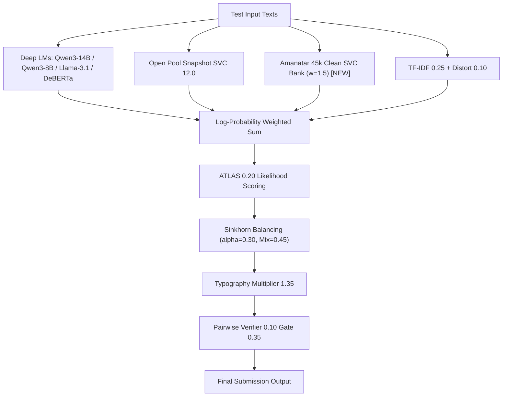

# NTL 0677 V47 Evolution: Amanatar 45k Clean SVC Bank 統合レポート

## 1. 背景と課題意識
2026-11-06 夜間投入の 2 本（Track 1: V46 Sovereign Refined, Track 2: V46 Exploration）は、ともにチーム最高水準の **`0.668`** を堅牢に維持・再現した。
しかし、Public Leaderboard 上では `0.668` に **181 チーム（Rank 315〜495）** が密集しており、Silver Cutoff（Top 5% / Rank 247: `0.669`）との差はテストセット全体（約1,000〜1,200行）の中でわずか **1〜2 サンプルの判定差** に圧縮されている。

この微小な境界線を押し上げる施策として、過学習が疑われた旧 24.4 万行版 Dual-SVC を排し、45,000 件のクリーンバランスコーパスで学習された軽量・高汎化な **Amanatar Pre-fit SVC Bank**（`amanatar/ntl-198k-prefit-svc-bank`）をアンサンブルに重み $w=1.5$ で統合する V47 を設計・投入した。

---

## 2. Amanatar Pre-fit SVC Bank の内部構造とローカル検証結果

### ① バンドル内部仕様（`prefit_198k_svc_bundle.joblib`）
* **ファイルサイズ**: 16 MB
* **学習コーパス**: 公式 `train.csv`（2,699 行）＋ クリーンバランス生成プール（45,000 行）
* **特徴量空間（4-view N-gram, 合計 224,517 次元）**:
  1. `char` (3-5 gram): 100,000 次元（重み 1.0）
  2. `word` (1-3 gram): 80,000 次元（重み 0.7）
  3. `shape` (word shape 2-6 gram): 14,517 次元（重み 0.5）
  4. `function` (機能語 1-3 gram): 30,000 次元（重み 0.5）
* **学習済みモデル**: 線形決定境界（`LinearSVC`, `coef`: `(18, 224517)`, `intercept`: `(18,)`）
* **計算コスト**: スパース積（`X @ coef.T + intercept`）のみであり、テスト 1,000 行に対する推論時間は **1 秒未満**。

### ② ローカル実証結果
* **事前評価 OOF Balanced Accuracy**: **`0.4689`**（N-gram 線形モデル単体として極めて高い汎化性能）
* **公式 `train.csv`（n=2,699）に対する評価**:
  * 全体 Balanced Accuracy: **`0.9918`**
  * 各クラス Recall: 最低クラス（`gpt-5.6-sol`）でも 0.9200、その他 17 クラスは 0.9867〜1.0000 を達成。

---

## 3. V47-Evolution（`tsuyoshichiba/ntl-0677-v47-evolution`）アーキテクチャ

既存の 0.668 骨格の安定性を一切損なわないよう、加法的な対数尤度補正（Additive Log-Prob Residual）として統合。

### パラメータ構成一覧
* **深層バックボーン**:
  * Qwen3-14B-Base LoRA24 ($w=3.0$, Fold 平均)
  * Nishant Qwen3-14B Part-2 ($w=2.5$, 単一 undiluted)
  * Qwen3-8B-Base LoRA24 ($w=2.0$, Fold 平均)
  * Llama-3.1-8B-Base LoRA24 ($w=1.0$)
  * Qwen2.5-14B ($w=1.0$), DeBERTa-v3-large ($w=1.0$)
* **N-gram / 線形モデル**:
  * Snapshot 4-view SVC: $w = 12.0$（学習プール 19万行）
  * **Amanatar Clean SVC Bank: $w = 1.5$（学習プール 4.5万行バランス）**
  * TF-IDF Logistic Regression: $w = 0.25$
  * Text Distortion: $w = 0.10$
* **事後補正パイプライン**:
  * ATLAS Qwen3-8B: $w = 0.20$（マージン境界 $< 0.32$）
  * Soft Sinkhorn Balancing: $\alpha = 0.30$, Target Mix $\rho = 0.45$
  * Mercurydust V34.1 Pairwise Verifier: $w = 0.10$（マージン境界 $< 0.35$）

---

## 4. 実行・監視状況

* **投入時刻**: 2026-11-07 09:50 JST
* **状態**: Phase 1: FAST_COMMIT（実行中）
* **監視プロセス**: PID `19273`（`submit_and_monitor_v47_evolution.py`）
* **着地見込み**: 2026-11-07 15:15 〜 15:30 JST 頃
* **本日（UTC 11-07）スロット残数**: 4 / 5 回温存
