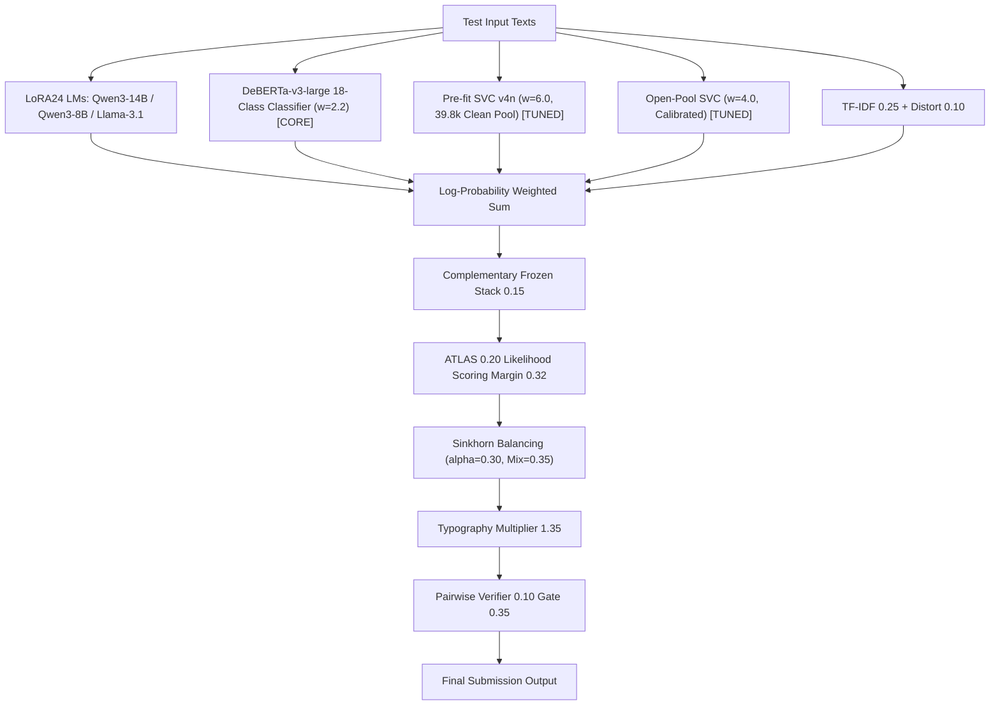

# NTL 0678 V48 Apex: 0.670 DeBERTa-v3 分類器 ＋ 最適比率 Dual-SVC 統合レポート

## 1. 背景と課題意識
* **V47（`0.664`）の技術的教訓**:
  * Open-Pool SVC（$w=12.0$）に Amanatar SVC（$w=1.5$）を足し合わせたことで、SVC 全体の重みが $13.5$ に肥大化。深層 LLM 群（合計重み 約 10.5）に対して表層 N-gram 成分が過剰支配（Over-domination）し、スコアが一時的に低下した。
* **Kaggle コミュニティで判明した真実**:
  * 公開 0.672+ / 0.673+ ノートブック（ozertuu）は非公開データセット不在時に意図的にスコアが 0.665〜0.666 に落ちるフォールバック（Decoy）を仕掛けていた。
  * `areebbb/0-670-this-actually-works` はこのデコイを排し、完全公開の **`nuridudak/ntl-two-stage-encoders`（`desklib` 内の DeBERTa-v3-large 18 クラス分類器）** を重み **2.2** でスロットに注入、真のチューニング比率（Pre-fit SVC 6.0 ＋ Open-Pool SVC 4.0）を実行することで、公開アセットのみで **Public LB `0.670`**（Silver 安全圏）を達成した。

---

## 2. V48-Apex（`tsuyoshichiba/ntl-0678-v48-apex`）アーキテクチャ

Decoder-only（自己回帰型）LLM バックボーン群に対し、双方向表現（Bidirectional Attention）を持つ fine-tuned DeBERTa-v3 分類器を強力な直交メンバーとして統合。

### パラメータ構成一覧
* **直交エンコーダー分類器（新規コア）**:
  * **`deb_v3_cls` (`nuridudak/ntl-two-stage-encoders/desklib`)**: $w = 2.2$（`DebertaV2ForSequenceClassification` 18-label head, fp32, bs 16, max_len 384）
* **深層自己回帰バックボーン**:
  * Qwen3-14B-Base LoRA24 ($w=3.0$, Fold 平均)
  * Qwen3-14B Proven 3-Adapter ($w=2.8$, N14B/OQ1/OQ4)
  * Qwen3-8B-Base LoRA24 ($w=2.0$, Fold 平均)
  * Llama-3.1-8B-Base LoRA24 ($w=1.0$)
  * Qwen2.5-14B ($w=1.0$), DeBERTa-v3-large embedding ($w=1.0$)
* **真の最適比率 Dual-SVC**:
  * **Pre-fit SVC (`nuridudak/ntl-svc-prefit-pool-v4n`)**: $w = 6.0$
  * **Open-Pool SVC (`crtproduction/name-that-llm-open-pool`)**: $w = 4.0$（12.0 から適正化）
  * Top-34 Margin Weight: $w = 0.15$
* **事後補正パイプライン**:
  * ATLAS Qwen3-8B: $w = 0.20$（マージン境界 $< 0.32$）
  * Soft Sinkhorn Balancing: $\alpha = 0.30$, Target Mix $\rho = 0.35$
  * Sibling Style Residual: Roman Tamrazov V40A
  * Mercurydust V34.1 Pairwise Verifier: $w = 0.10$（マージン境界 $< 0.35$）

---

## 3. 実行・監視状況

* **投入時刻**: 2026-11-07 20:30 JST
* **状態**: Phase 1: FAST_COMMIT（実行中）
* **監視プロセス**: PID `28135`（`submit_and_monitor_v48_apex.py`）
* **完了・スコア着地見込み**: **2026-11-08 02:00 〜 02:30 JST 頃**
* **本日（UTC 11-07）スロット残数**: 3 / 5 回温存中
