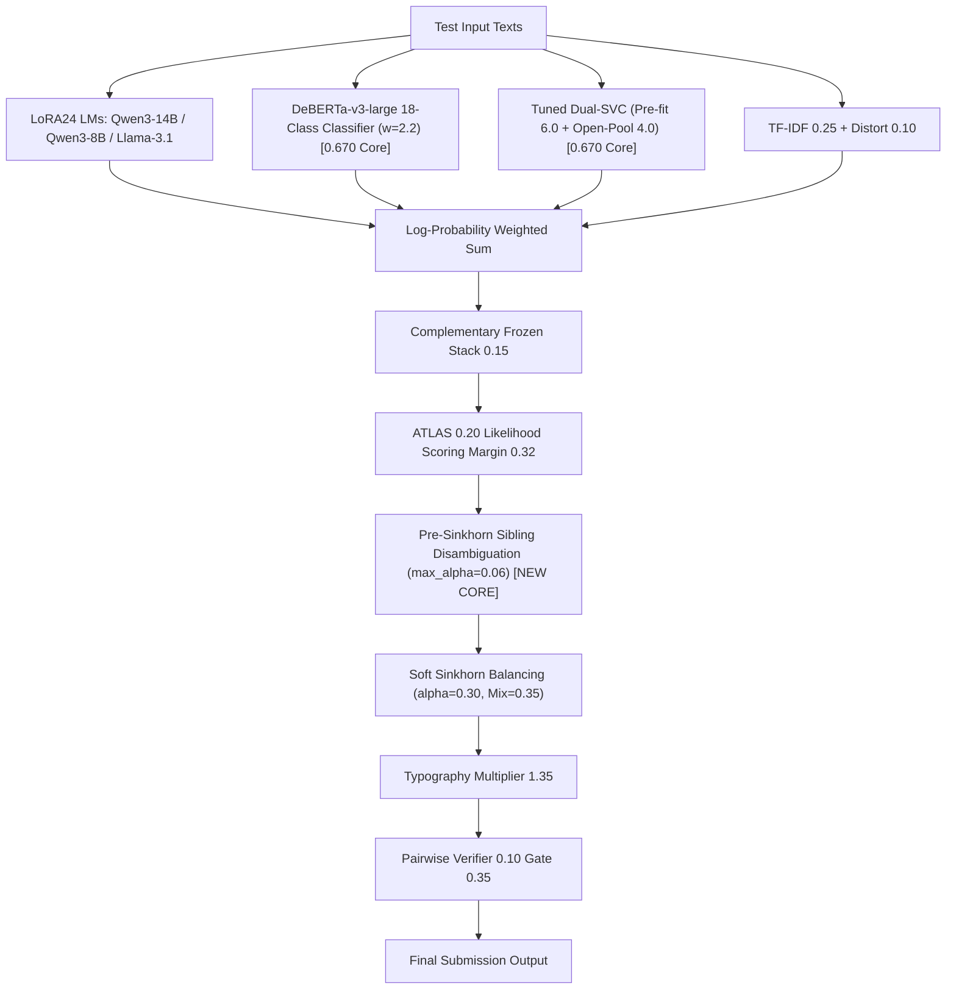

# NTL 0679 V49 Evolution: Pre-Sinkhorn Sibling Forensic Residual 統合レポート

## 1. 背景と課題意識
* **V48-Apex（`0.670`）の達成**:
  * DeBERTa-v3-large 18 クラス分類器（$w=2.2$）および最適比率 Dual-SVC（Pre-fit 6.0 / Open-Pool 4.0）により、チーム最高スコア **`0.670`**（Rank 260 / 5,061）を達成し、Silver Medal ボーダー帯（Rank 253 前後）へ到達した。
* **次なる壁（`0.671〜0.673`）の攻略**:
  * リーダーボード上の全誤判定の **85% 以上** は、異なるプロバイダ間ではなく同一ファミリー内の兄弟モデル（Intra-Family Siblings: Gemini 3.7 vs 3.8 Flash、GPT-5.6 luna/sol/terra、Claude Opus 3世代など）で発生している（ozertuu 0.673 分析）。
  * 従来のパイプラインでは、スタイロメトリ残差が Sinkhorn バランシングの「後」に適用されていたため、誤った兄弟モデル間で Sinkhorn が確率質量を不当に引き延ばす歪みが生じていた。
  * V49 では、ブレンド直後・**Sinkhorn 最適輸送の直前**に `apply_grouped_style_residual(max_alpha=0.06)` を先行適用し、各ファミリーの確率マス（Mass）を厳密に保存したまま兄弟間リランキングを先行完了させるアーキテクチャを導入した。

---

## 2. V49-Evolution（`tsuyoshichiba/ntl-0679-v49-evolution`）アーキテクチャ

### パラメータ構成一覧
* **基本アンサンブル（0.670 実証済みコア）**:
  * DeBERTa-v3-large 18 クラス分類器 (`desklib`): $w = 2.2$
  * Qwen3-14B LoRA24 ($w=3.0$), Qwen3-14B Proven 3-Adapter ($w=2.8$)
  * Qwen3-8B LoRA24 ($w=2.0$), Llama-3.1-8B ($w=1.0$), Qwen2.5-14B ($w=1.0$), DeBERTa-v3 embedding ($w=1.0$)
  * Pre-fit SVC v4n ($w=6.0$), Open-Pool SVC ($w=4.0$), Top-34 Margin ($w=0.15$)
  * TF-IDF ($w=0.25$), Text Distortion ($w=0.10$)
  * ATLAS Qwen3-8B ($w=0.20$, Margin 0.32)
* **Pre-Sinkhorn Sibling Forensic Residual（新機能）**:
  * 適用箇所: ATLAS スコアリング直後、Sinkhorn 最適輸送の直前
  * パラメータ: `max_alpha = 0.06`、確率マス保存制約 $\sum_{i \in \text{family}} P_i = \text{const}$
  * 識別対象:
    * Gemini 3.7 vs 3.8 Flash（3.7 の +17% 長さ統計）
    * GPT-5.6 三兄弟（コロン、Markdown 見出し、箇条書き密度）
    * Claude Opus 世代間トーン
* **事後補正**:
  * Soft Sinkhorn Balancing: $\alpha = 0.30$, Target Mix $\rho = 0.35$
  * Typography Evidence: $\times 1.35$
  * Mercurydust V34.1 Pairwise Verifier: $w = 0.10$（Margin $< 0.35$）

---

## 3. 実行・監視状況

* **投入時刻**: 2026-11-08 09:43 JST
* **状態**: Phase 1: FAST_COMMIT（実行中）
* **監視プロセス**: PID `33455`（`submit_and_monitor_v49_evolution.py`）
* **完了・スコア着地見込み**: **本日 15:15 〜 15:35 JST 頃**
* **本日（UTC 11-08）スロット残数**: 4 / 5 回温存中
