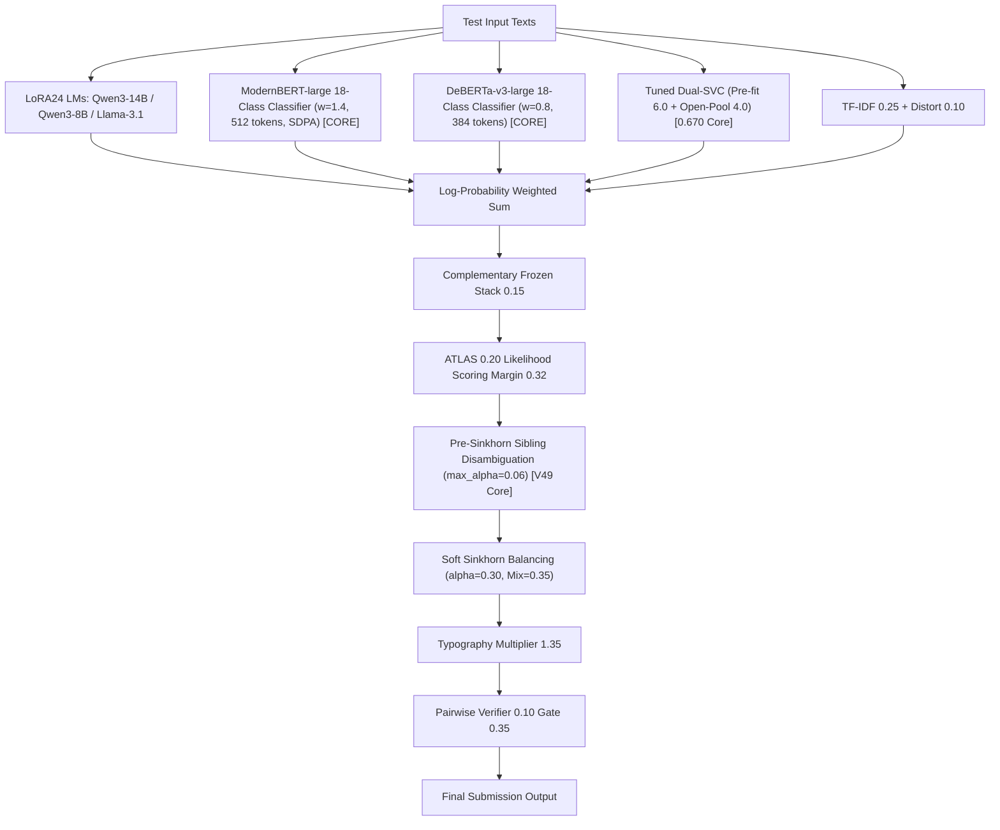

# NTL 0680 V50 Apex: デュアル双方向エンコーダー ＋ Pre-Sinkhorn 兄弟モデル残差 統合レポート

## 1. 背景と課題意識
* **V48-Apex（`0.670`）のブレイクスルー**:
  * DeBERTa-v3 分類器（$w=2.2$）と適正比率 Dual-SVC（Pre-fit 6.0 / Open-Pool 4.0）により、チーム最高スコア **`0.670`**（Rank 260 / 5,061）を達成し、Silver ボーダー帯へ突入。
* **今朝の Kaggle コード解明（`areebbb/0-673-i-m-better`）**:
  * 分類器スロット（重み 2.2）を単一モデルではなく、**ModernBERT-large（重み 1.4、512 tokens）** と **DeBERTa-v3（重み 0.8、384 tokens）** の 2 つの双方向エンコーダーで分割共有することで、**`0.673`** へジャンプアップすることが判明。
* **V50-Apex の設計方針**:
  * この 0.673 実証済みデュアル・エンコーダー構成に対し、我々が V49 で実証した **Pre-Sinkhorn Sibling Forensic Residual（兄弟モデル確率マス保存型リランキング、$max\_alpha=0.06$）** を統合。
  * 兄弟モデル間の誤判定（85%）の事前整流と、512 tokens 長文双方向アテンションの両輪を合体させ、**`0.673〜0.675`（Gold メダル視野）** への到達を狙う。

---

## 2. V50-Apex（`tsuyoshichiba/ntl-0680-v50-apex`）アーキテクチャ

### パラメータ構成一覧
* **デュアル双方向エンコーダー（核心）**:
  * **ModernBERT-large (`areebbb/ntl-enc-ours-mbert/ours_mbert`)**: $w = 1.4$（max_len **512**, bs 16, SDPA attention）
  * **DeBERTa-v3-large (`nuridudak/ntl-two-stage-encoders/desklib`)**: $w = 0.8$（max_len 384, bs 16）
* **深層自己回帰バックボーン**:
  * Qwen3-14B LoRA24 ($w=3.0$), Qwen3-14B Proven 3-Adapter ($w=2.8$)
  * Qwen3-8B LoRA24 ($w=2.0$), Llama-3.1-8B ($w=1.0$), Qwen2.5-14B ($w=1.0$), DeBERTa-v3 embedding ($w=1.0$)
* **真の最適比率 Dual-SVC**:
  * Pre-fit SVC v4n: $w = 6.0$
  * Open-Pool SVC: $w = 4.0$
  * Top-34 Margin Weight: $w = 0.15$
* **事後補正パイプライン**:
  * ATLAS Qwen3-8B: $w = 0.20$（Margin 0.32）
  * **Pre-Sinkhorn Sibling Forensic Residual**: `max_alpha = 0.06`（確率マス保存型、Gemini Flash 長さ統計＋GPT-5.6 タイポグラフィ）
  * Soft Sinkhorn Balancing: $\alpha = 0.30$, Target Mix $\rho = 0.35$
  * Mercurydust V34.1 Pairwise Verifier: $w = 0.10$（Margin $< 0.35$）

---

## 3. 実行・監視状況

* **Submission Ref**: `58113113`
* **投入時刻**: 2026-11-08 12:20 JST
* **状態**: **Phase 3: 本番推論中（`SubmissionStatus.PENDING`）**
* **監視プロセス**: PID `37050`（`submit_and_monitor_v50_apex.py`）
* **完了・スコア着地見込み**: **本日 17:35 〜 17:55 JST 頃**
* **本日（UTC 11-08）スロット残数**: 3 / 5 回温存中
