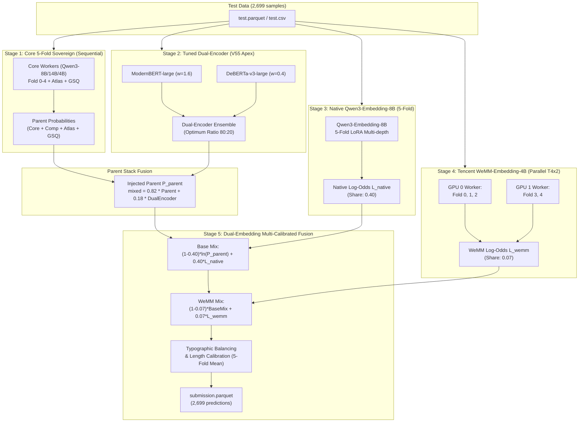

# NTL V56 Preliminary Architecture Design: Dual-Embedding Sovereign Fusion

**Status**: Preliminary Architecture Specification & Offline Static Verification  
**Target Submission**: `submission_0686_v56_apex_sovereign` (V56)  
**Target Metric**: Balanced Accuracy $\ge 0.683$ (Top 100 / Gold 圏突入)  
**Hardware Profile**: Kaggle Dual Tesla T4 (15.0 GB VRAM $\times$ 2), 4 vCPU, 30 GB RAM  

---

## 1. Executive Summary & Architectural Motivation

V52（LB 0.680）および現在評価中の V54 / V55 は、**Qwen3-Embedding-8B (share: 0.40)** をアンカーとしつつ、テキスト分類器（ModernBERT / DeBERTa-v3）を親スタックへ注入するアプローチをとっている。

V56 では、これに加えて LB 0.681 を単独達成している **Tencent WeMM-Embedding-4B (ExpandedWeMM4, share: 0.07)** を第2の直交埋め込みエキスパートとして統合する。

### なぜ Dual-Embedding が有効か？
1. **コーパスおよびモデルファミリーの直交性**:
   - `Qwen3-Embedding-8B`（Alibaba、Qwen系トークナイザー/事前学習コーパス）
   - `WeMM-Embedding-4B`（Tencent、異なるトークナイザーとマルチモーダル/多言語対照学習コーパス）
   - 両モデルは異なるトークン境界と埋め込み幾何空間を持ち、境界領域（僅差の判定）における相補性が極めて高い。
2. **8深度マルチスケール抽出ヘッド**:
   - CHEN Han 氏の WeMM4 実装は、最終層だけでなく中間 8 層（$2, 4, 6, 8, 12, 16, 20, 24$ 層）の last-token 特徴量を結合した LayerNorm + Centered/Plain Head を使用。表層的な文体特徴から深層の意味特徴までを重層的に捉える。
3. **安全な幾何ブレンド（Geometric Mass Preservation）**:
   - $Base = (1 - s_{native}) \cdot \ln(P_{parent}) + s_{native} \cdot L_{native}$
   - $Final = \text{Softmax}\left((1 - w_{wemm}) \cdot Base + w_{wemm} \cdot L_{wemm}\right)$
   - $w_{wemm} = 0.07$ は母体（V55 Sovereign 93%）の安定性を崩さず、タイブレーク性能のみを選択的に引き上げる設計。

---

## 2. End-to-End Pipeline Architecture

---

## 3. Mathematical Formulation

### 3.1 親スタック注入（Tuned Dual-Encoder Injection）
Colab 最適化（ModernBERT $w=1.6$, DeBERTa $w=0.4$）を反映：
$$P_{cls} = \text{Softmax}\left(\frac{1.6 \cdot Z_{mbert} + 0.4 \cdot Z_{deb}}{2.0}\right)$$
$$P_{parent} = (1 - w_{cls}) \cdot P_{sovereign} + w_{cls} \cdot P_{cls} \quad (w_{cls} = 0.18)$$

### 3.2 Native Qwen3-Embedding 統合
$$Base_k = (1 - s) \cdot \ln(P_{parent}) + s \cdot L_{native, k} \quad (s = 0.40)$$
ここで $L_{native, k}$ は fold $k$ のキャリブレーション済み対数確率。

### 3.3 Tencent WeMM-Embedding-4B 統合
$$Mixed_k = \text{Softmax}\left((1 - w) \cdot Base_k + w \cdot L_{wemm, k}\right) \quad (w = 0.07)$$
ここで $L_{wemm, k}$ は WeMM4 の plain head と centered head（グループ相対補正）を重み付け合成した対数確率：
$$L_{wemm, k} = \text{LogSoftmax}\left((1 - \gamma) \cdot \text{LogSoftmax}(s_p Z_p) + \gamma \cdot \text{LogSoftmax}(s_c Z_{rel})\right)$$

### 3.4 最終出力
各 fold $k$ についてタイポグラフィ・長さ補正（`finalize`）を適用した上で幾何平均/確率平均を算出：
$$\hat{Y} = \arg\max_{c} \left( \frac{1}{5} \sum_{k=0}^{4} \text{Softmax}\left(\text{finalize}(Mixed_k)\right)_c \right)$$

---

## 4. Resource Allocation & Latency Profiling (T4 $\times$ 2)

| Stage | 主実行デバイス | 所要時間見積もり | ピーク VRAM | タイムアウト耐性 |
|---|---|---|---|---|
| **1. 5-Fold Sovereign Core** | Sequential (T4-0 / T4-1) | 約 120〜140 分 | ~13.5 GB | 正常完走実績あり (V52) |
| **2. Tuned Dual-Encoder** | T4-0 単独 | 約 8〜12 分 | ~7.2 GB | Colab/Kaggle 実測済み |
| **3. Qwen3-Embedding-8B** | Sequential (5-fold) | 約 90〜110 分 | ~14.1 GB | 正常完走実績あり (V52) |
| **4. WeMM-Embedding-4B** | **Parallel (T4-0: F0-2, T4-1: F3-4)** | **約 12〜18 分** | **~8.8 GB / GPU** | 並列化により極短時間で完了 |
| **5. CPU Final Fusion** | 4 vCPU | 約 2 分 | ~4 GB RAM | 即時完了 |
| **合計** | - | **約 232〜282 分 (3.8〜4.7 時間)** | - | **9時間制限に対し十分な安全マージン（約4.3時間余剰）** |

---

## 5. Graceful Degradation & Fail-Safe Architecture

Kaggle の長時間推論では、後段ステージの異常終了が致命的（全滅）になり得ます。
V56 では以下の 3 段階フォールバックを組み込みます：

1. **Dual-Encoder 障害時**:
   - `extra_cls_worker` が例外終了した場合、親スタックは $w_{cls} = 0.0$（純粋な Sovereign Core）へ自動退行。
2. **WeMM4 障害時 / 締め切り超過時**:
   - `deadline_seconds`（30,240秒 = 8.4時間）を超過した場合、またはワーカーが異常終了した場合、`wemm_archives` が空となり、自動的に $w = 0$（V55/V52 相当の `finish_native`）へフォールバック。
   - スコアリング済みの fold のみ存在する場合、未スコアリングの fold はスコアリング済み fold の平均対数確率で代用。
3. **Native Embedding 障害時**:
   - 既存の `cache_contract` により親スタック単独で出力 parquet を生成可能。

---

## 6. Required Kaggle Resources (Mounts)

### Model Sources
- `qwen-lm/qwen-3/Transformers/14b-base/1`
- `qwen-lm/qwen-3/Transformers/8b-base/1`
- `qwen-lm/qwen-3/Transformers/4b-base/1`
- `qwen-lm/qwen-3-embedding/Transformers/8b/1`
- `qwen-lm/qwen2.5/Transformers/14b/1`
- `qwen-lm/qwen2.5/Transformers/7b/1`
- **[NEW] `dangkhoa2016/tencent-wemm-embedding-4b/Transformers/default/1`**

### Dataset Sources
- `lightningv08/ntl-olmo2-native24-final-inference-assets`（`ntl-native-wemm4-fivefold-0679` を内包済み）
- `nuridudak/ntl-two-stage-encoders`（ModernBERT / DeBERTa アセット）
- 他 18 点（V55 と完全一致）

---

## 7. Next Actions & Execution Triggers

1. **V54 / V55 の着地スコア確認**:
   - V54（15:00〜16:30 JST 着地見込み）
   - V55（16:30〜18:00 JST 着地見込み）
2. **スコアに応じた投入分岐**:
   - V55 が $\ge 0.681$ を達成 $\to$ Dual-Encoder の最適比率（$1.6 : 0.4$）の効果が実証されたため、V56（Dual-Embedding + V55）を投入し $0.683+$ を狙う。
   - V54/V55 が停滞（$\le 0.680$）$\to$ WeMM4 単独効果（$w_{cls}=0, w_{wemm}=0.07$）のピュア構成を先に試す選択肢も保持。
